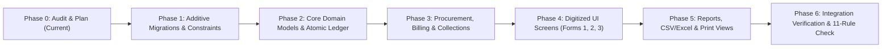

# PAGECOM IATMS INTEGRATION & MIGRATION PLAN
**Phase 0 Deliverable: System Baseline Audit, Schema Mapping & Architecture Blueprint**

**Host System:** Pagecom Inc. / SYB Business Management System (BMS)  
**Reference System:** PAGECOM Inventory & Asset Tracking Management System (IATMS) (`c:\xampp\htdocs\pagecom-inventory`)  
**Database Target:** `business_management_system` (MariaDB 10.4.32-MariaDB InnoDB, `utf8mb4_unicode_ci` on XAMPP)  
**Date:** November 2026  
**Document Status:** Complete Phase 0 Audit & Blueprint — Awaiting Stakeholder Confirmation  

---

## 1. Executive Summary & Existing System Audit

This plan establishes the architecture for integrating the complete operational workflows, relational data models, atomic double-entry ledger, digitized paper-form interfaces (Form 1 Stock In, Form 2 Stock Out, Form 3 Ending Balance), warranty engine, billing/collection pipeline, and 11-rule data integrity engine of the **PAGECOM Inventory & Asset Tracking Management System (IATMS)** into the existing **Pagecom Inc. / SYB Business Management System (BMS)**.

### 1.1 Technical Stack Comparison & Baseline Compatibility

| Component | Host BMS System (`c:\xampp\htdocs\BMS`) | Reference IATMS (`c:\xampp\htdocs\pagecom-inventory`) | Integration Compatibility & Strategy |
| :--- | :--- | :--- | :--- |
| **Language & Runtime** | Native PHP 8.2+ (strict types) | Native PHP 8.2+ (strict types) | **100% Identical runtime.** Direct code compatibility. |
| **Framework Style** | Custom Native MVC (Front Controller) | Custom Native MVC (Front Controller) | **Identical architecture.** Models, Controllers, Views, Core helpers. |
| **Database Engine** | MariaDB 10.4.32 / MySQL 8.0+ InnoDB | MariaDB 10.4.32 / MySQL 8.0+ InnoDB | **100% Parity.** InnoDB row-level locking (`FOR UPDATE`), transactions, FKs. |
| **Web Server** | Apache (XAMPP Windows, port 80) | Apache (XAMPP Windows, port 80) | Compatible `.htaccess` rewrite rules mapping to `/public/index.php`. |
| **CSS Framework** | Bootstrap 5.3.3 + Custom Design System | Bootstrap 5.3.3 + Custom Design System | Harmonious UI component structure, cards, badges, and modals. |
| **Routing Mechanism** | `App\Core\Router` with explicit `$router->get/post` in `routes/web.php` | `App\Core\Router` with route conventions | Integrate explicit routes into `routes/web.php` maintaining BMS conventions. |
| **Auth & Security** | Session-based, CSRF token validation on POST, `password_hash()` | Session-based, CSRF tokens, `password_hash()` | Use BMS `AuthMiddleware`, `CsrfMiddleware`, and `AuthorizationService`. |
| **RBAC Model** | Dual-Layer: Database RBAC (`roles`, `permissions`) + Department code | Database RBAC (`roles`, `permissions`) | Map permissions into BMS RBAC and enforce department gates in PHP. |

### 1.2 Non-Destructive Principles
1. **Zero Data Loss:** Existing tables (`users`, `roles`, `departments`, `projects`, `suppliers`, `purchase_requests`, `purchase_orders`, `activity_logs`, `project_documents`) are preserved with all existing records intact.
2. **Additive Modifications Only:** Column changes on existing tables will strictly use `ADD COLUMN IF NOT EXISTS` and nullable foreign keys to maintain 100% backward compatibility.
3. **Preserve Leading Zeros:** `po_number` (e.g. `000398`), `dr_number`, `invoice_number`, `pr_number`, and `serial_number` are strictly stored as `VARCHAR`, never cast to numeric types.
4. **Double-Entry Perpetual Ledger:** Every physical stock movement will atomically write to `inventory_ledger` and `stock_transactions`, while synchronizing `inventory_stock` cached balances and individual physical unit records in `inventory_units`.

---

## 2. Master Table Mapping & Integration Strategy

A detailed audit of the 25 existing tables in `business_management_system` against the 41 tables in `iatms_db` was performed. Master tables are mapped to reuse existing entities and create new supporting tables where entities do not currently exist.

```mermaid
graph TD
    subgraph MASTER_EXISTING["Existing BMS Master Tables (Reused & Extended)"]
        U["users (6 rows)"]
        R["roles (2 rows) & permissions (48 rows)"]
        D["departments (6 rows)"]
        P["projects (2 rows)"]
        S["suppliers (3 rows)"]
        PR["purchase_requests (2 rows)"]
        PO["purchase_orders (4 rows)"]
        AL["activity_logs (360 rows)"]
        II["inventory_items (1 row)"]
        IU["inventory_units (0 rows)"]
        IT["inventory_transactions (0 rows)"]
    end

    subgraph IATMS_NEW["New IATMS Operational Tables to Add"]
        C["clients (New Master)"]
        PT["payment_terms (New Master)"]
        CAT["categories & equipment_models"]
        LOC["inventory_locations"]
        IS["inventory_stock (Ending Balance Cache)"]
        IL["inventory_ledger (Immutable Ledger)"]
        STX["stock_transactions & detail serials"]
        SR["supplier_receipts & serials (Stock In / Form 1)"]
        CD["customer_deliveries & updates (Stock Out / Form 2)"]
        INV["invoices & invoice_items"]
        COL["collections"]
        WAR["warranties & warranty_claims"]
        DSH["daily_status_history & settings"]
    end

    U --> AL
    U --> PR
    U --> PO
    U --> SR
    U --> CD
    S --> PO
    S --> SR
    C --> CD
    C --> INV
    C --> WAR
    II --> IS
    II --> IU
    II --> IL
    IU --> WAR
```



### 2.1 Entity Mapping Breakdown

| Master Entity | IATMS Reference Table | BMS Existing Table | Integration Action & Schema Strategy |
| :--- | :--- | :--- | :--- |
| **Users** | `users` (`id`, `name`, `email`, `password`, `role_id`, `is_active`) | `users` (`id`, `full_name`, `username`, `email`, `password_hash`, `department_id`, `role_id`, `status`) | **REUSE EXISTING `users`**: Existing 6 users preserved intact. System maps `name` $\leftrightarrow$ `full_name`, `password` $\leftrightarrow$ `password_hash`, `is_active` $\leftrightarrow$ `status = 'active'`. |
| **Roles & Permissions** | `roles`, `permissions`, `role_permissions` | `roles`, `permissions`, `role_permissions` | **REUSE EXISTING RBAC**: Seed new IATMS permissions (`inventory.stock_in.*`, `inventory.stock_out.*`, `inventory.ending_balance.*`, `warranties.*`, `invoices.*`, `collections.*`, `reports.*`). |
| **Suppliers / Vendors** | `suppliers` (`id`, `supplier_code`, `company_name`, `contact_person`, `email`, `phone`, `address`, `tax_id`, `payment_term_id`) | `suppliers` (`id`, `supplier_code`, `supplier_name`, `contact_person`, `email`, `phone`, `address`, `tax_identification_number`, `default_payment_terms`, `status`) | **REUSE & EXTEND `suppliers`**: 3 existing suppliers preserved. Add additive column `payment_term_id` (INT UNSIGNED NULL FK to `payment_terms.id`). System maps `company_name` $\leftrightarrow$ `supplier_name`, `tax_id` $\leftrightarrow$ `tax_identification_number`. |
| **Clients / Customers** | `clients` (`id`, `client_code`, `company_name`, `contact_person`, `email`, `phone`, `billing_address`, `shipping_address`, `tax_id`, `payment_term_id`) | Client data previously stored ad-hoc in `projects.client_name` and `projects.client_contact` | **CREATE NEW MASTER TABLE `clients`**: Normalized client registry. Ad-hoc client entries during Stock Out will automatically upsert into `clients`. Existing project client names can be cross-linked. |
| **Payment Terms** | `payment_terms` (`id`, `code`, `name`, `days`, `description`, `is_active`) | `payment_terms_schedules` (specific PO payment milestone instances) | **CREATE NEW MASTER TABLE `payment_terms`**: Master dictionary (e.g. `COD`, `NET30`, `50_DP_50_DELIVERY`). Relates to `suppliers`, `clients`, `purchase_orders`, and `invoices`. |
| **Catalog / Items** | `products`, `categories`, `equipment_models` | `inventory_items` (`id`, `item_code`, `item_name`, `model_part_number`, `category`, `unit_of_measure`, `is_serialized`, `current_balance`, `description`, `status`) | **REUSE & EXTEND `inventory_items`**: Create `categories` and `equipment_models`. Extend `inventory_items` with additive columns: `sku`, `category_id`, `model_id`, `default_warranty_months` (DEFAULT 24), `reorder_level` (DEFAULT 5), `reorder_quantity` (DEFAULT 10), `unit_cost`, `unit_price`. |
| **Locations** | `inventory_locations` (`id`, `code`, `name`, `description`, `is_active`) | Hardcoded `'PCT Warehouse'` in existing columns | **CREATE NEW MASTER TABLE `inventory_locations`**: Seed default `'PCT Warehouse'` (code: `MAIN-WH`) and `'Jobsite Staging'` (code: `JOBSITE`). |
| **Running Stock Balance** | `inventory_stock` (`id`, `product_id`, `location_id`, `quantity_on_hand`, `quantity_reserved`, `quantity_available`, `remarks`) | `inventory_items.current_balance` (single running scalar) | **CREATE NEW TABLE `inventory_stock`**: Tracks location-level quantities and stores the **persistent, inline-editable line-item remarks for Paper Form 3 Ending Balance**. Synchronized with `inventory_items.current_balance`. |
| **Perpetual Ledger** | `inventory_ledger` (`id`, `product_id`, `location_id`, `transaction_type`, `reference_type`, `reference_id`, `quantity_in`, `quantity_out`, `balance_after`, `unit_cost`, `performed_by_id`, `notes`) | `inventory_transactions` (`id`, `transaction_number`, `transaction_type`, `quantity`, `balance_before`, `balance_after`, `reference_type`, `reference_id`) | **CREATE `inventory_ledger` & COMPLEMENT `inventory_transactions`**: Provides strict double-entry ledger with exact `quantity_in` and `quantity_out` columns, unit costs, and immutable audit timestamps. |
| **Physical Serial Units** | `inventory_units` (`id`, `product_id`, `serial_number`, `barcode`, `status`, `location_id`, `supplier_id`, `client_id`, `unit_cost`, `warranty_expiry_date`, `notes`) | `inventory_units` (`id`, `serial_number`, `model`, `description`, `warranty_duration`, `in_qty`, `inventory_date`, `inventory_item_id`, `status`, `current_location`) | **REUSE & EXTEND `inventory_units`**: Add additive columns `client_id`, `location_id`, `barcode`, `po_reference`, `dr_reference`, `stock_in_date`, `stock_out_date`, `warranty_start_date`, `warranty_expiry_date`. Harmonize statuses: `in_stock`, `delivered`, `under_repair`, `damaged`, `returned`, `scrapped`. |
| **Stock In / Receiving (Form 1)** | `supplier_receipts`, `supplier_receipt_items`, `supplier_receipt_serials` | `supplier_deliveries`, `supplier_delivery_items` (1 row) | **CREATE `supplier_receipts`, `supplier_receipt_items`, `supplier_receipt_serials`**: Implements the Dual-Mode Stock In engine (Mode A: Direct Stock In without PO; Mode B: Receive Against System PO) matching Paper Form 1. |
| **Stock Out / Dispatch (Form 2)** | `customer_deliveries`, `customer_delivery_items`, `customer_delivery_serials`, `customer_delivery_updates` | `stock_out_issuances`, `stock_out_items` (Drafted in Phase 2 migration) | **CREATE `customer_deliveries`, `customer_delivery_items`, `customer_delivery_serials`, `customer_delivery_updates`**: Implements the Paper Form 2 dispatch engine with Delivery Receipt (`dr_number`), Sales Invoice (`invoice_number`), and serial transitions. |
| **Invoices & Billing** | `invoices`, `invoice_items` | None (BMS only had PO supplier payment schedules) | **CREATE NEW TABLES `invoices`, `invoice_items`**: Manages customer billing linked to Delivery Receipts (DR) and supplier vendor invoices linked to POs. |
| **Collections** | `collections` (`id`, `collection_number`, `invoice_id`, `client_id`, `payment_method`, `amount_received`, `status`) | None | **CREATE NEW TABLE `collections`**: Records partial/full payments with automatic balance updates, receipt printing, and auditable voiding workflows. |
| **Warranty & RMA** | `warranties`, `warranty_claims` | None | **CREATE NEW TABLES `warranties`, `warranty_claims`**: Calculates 24-month warranties starting upon delivery, tracks claims, and supports authorized warranty adjustments. |
| **Audit Logs** | `audit_logs` (`id`, `user_id`, `action`, `entity_type`, `entity_id`, `old_values`, `new_values`, `ip_address`, `user_agent`) | `activity_logs` (`id`, `user_id`, `action`, `entity_type`, `entity_id`, `description`, `ip_address`, `created_at`) (360 rows) | **REUSE & EXTEND `activity_logs`**: 360 existing log records preserved. Add additive columns `old_values` (LONGTEXT), `new_values` (LONGTEXT), `user_agent` (VARCHAR(255)). |
| **System Settings & Daily Metrics** | `settings`, `daily_status_history` | None | **CREATE NEW TABLES `settings`, `daily_status_history`**: System-wide configurations (e.g. default warranty months, reorder threshold alerts) and daily time-series operational snapshots. |

---

## 3. End-to-End Workflow Integration Specifications

### 3.1 Workflow 1: Master Catalog & Procurement Pipeline
* **Catalog:** Products managed with SKU, Model Code, Description, Category, Unit of Measure, Unit Cost, Unit Price, Reorder Level, and Serialized flag.
* **Purchase Requests:** Requisitions support project-linked or standalone requisitions with approval history (`draft` $\to$ `pending_approval` $\to$ `approved` $\to$ `partially_ordered` $\to$ `fully_ordered` / `cancelled`).
* **Purchase Orders:** Generated from approved PR quantities or direct PO creation with contracted payment terms. PO fulfillment is tracked dynamically (`awaiting_delivery` $\to$ `partially_received` $\to$ `fully_received`). Cancelling a PO releases outstanding quantities back to the PR.

### 3.2 Workflow 2: Dual-Mode Stock In / Receiving (Digitized Paper Form 1)
Supports two encoding paths unified under `App\Models\SupplierReceipt::recordReceipt()`:
* **Mode A — Direct Stock In (Paper Form 1):**
  * Direct encoding from paper Form 1 sheets or legacy supplier invoices without requiring a pre-existing system PO (`po_id = NULL`).
  * Captures: `PO Number` (string preserving leading zeros, e.g. `000398`), `PO Date`, `Delivery to PCT / Inventory Date`, `Supplier` (dropdown or ad-hoc `supplier_name`), `Destination Location`, `Waybill / DR Number`.
  * Detail lines: `Model`, `Description`, `Warranty Duration (months, default 24)`, `In Qty`, `Unit Cost`, and exact 1-to-1 serial numbers.
* **Mode B — Receive Against System PO:**
  * Linked to an open system PO (`po_id`).
  * Auto-populates vendor, items, and caps `quantity_received_now <= outstanding_quantity`. Increments PO line received counters.
* **Atomic Guarantees on Both Modes:**
  * Deduplicates serials against database and intra-form inputs.
  * Writes to `supplier_receipts`, `supplier_receipt_items`, and `supplier_receipt_serials`.
  * Inserts rows into `inventory_units` (`status = 'in_stock'`).
  * Posts double-entry debit to `inventory_ledger` and `stock_transactions`.
  * Increments `inventory_stock.quantity_on_hand` and `quantity_available`.

### 3.3 Workflow 3: Ending Balance & Physical Reconciliation (Digitized Paper Form 3)
* Screen matches Paper Form 3: `Description` | `Ending Balance` | `Remarks`.
* **Ending Balance Calculation:**
  $$\text{Ending Balance} = \text{Beginning Balance} + \text{Stock In} - \text{Stock Out}$$
  Strictly matches physical units currently `in_stock`, explicitly excluding `delivered`, `under_repair`, and `scrapped` units.
* **Persistent Inline Remarks:** Editable line-item notes (e.g. `"FOR MAINTENANCE REPLACEMENT"`) stored directly in `inventory_stock.remarks` and preserved across balance queries and export reports.
* **Authorized Adjustments:** Adjustments require documented justification, row-locking, and write an auditable record to `inventory_ledger` and `activity_logs`.

### 3.4 Workflow 4: Outbound Stock Out & Customer Delivery (Digitized Paper Form 2)
* **Form 2 Fields:** `Serial Number` (picker of `in_stock` units locked with `FOR UPDATE`), `Out Qty` (`1` per serial), `Out Date`, `Warranty Duration (months, default 24)`, `Company` (existing client or ad-hoc company name which auto-registers into `clients`), `Address` (shipping address), `Customer PO No. / Internal PR No.`, `DR No.` (unique Delivery Receipt string), and `Invoice No.`.
* **Atomic Issuance Execution:**
  * Transitions unit status: `in_stock` $\to$ `delivered`.
  * Links `client_id`, `delivery_id`, `dr_reference`, and `stock_out_date` on `inventory_units`.
  * Decrements `inventory_stock.quantity_available` and `quantity_on_hand`.
  * Writes credit entry to `inventory_ledger` and `stock_transactions`.
* **Customer Delivery Lifecycle:** Tracks status (`dispatched` $\to$ `in_transit` $\to$ `delivered`) with daily update remarks and recipient sign-off.
* **Reversal / Cancellation:** Cancelling an outbound delivery restores attached serialized units back to `in_stock`, increments `inventory_stock`, and posts an offsetting reversal entry to `inventory_ledger`.

### 3.5 Workflow 5: Invoices & Payment Collections
* **Invoices:** Supports receivable customer invoices (linked to Delivery Receipts) and payable vendor bills (linked to POs). Automatic subtotal, VAT calculation, and balance due tracking.
* **Collections:** Records cash, check, or bank transfer payments against invoices. Voiding a collection atomically restores the invoice balance and status.

### 3.6 Workflow 6: Warranty Lifecycle, Serial Dossier & Maintenance
* **Warranty Certificate:** Starts upon confirmed delivery date. Calculates 24-month expiration safely across leap years and month boundaries. Status derived dynamically: `active`, `expiring_soon` (within 30 days), `expired`, `voided`.
* **Maintenance Workflow:** Setting an `in_stock` unit to `under_repair` decrements `quantity_available` by 1 and blocks it from Stock Out issuance. Returning it to `in_stock` restores available stock by +1.
* **Complete Serial Dossier:** Comprehensive chronological history for any serial: Receiving $\to$ Maintenance $\to$ Stock Out DR $\to$ Warranty coverage and claims.

### 3.7 Workflow 7: Digitized Paper-Form Reports, Exports & Print Layouts
* **12 Comprehensive Reports:**
  1. Stock In Report (Form 1)
  2. Stock Out Report (Form 2)
  3. Ending Balance Report (Form 3)
  4. Inventory Balance & Valuation Report
  5. Stock-In & Supplier Receipts Audit
  6. Stock-Out & Customer Assignments Audit
  7. Purchase Requests & Approval History
  8. PO Status & Outstanding Quantities
  9. Supplier Delivery & Receiving Variances
  10. Customer Delivery Trajectory & Daily Status
  11. Invoices & Aging Due Dates
  12. Collections & Payment Settlements
* **CWE-1236 Anti-Formula Injection Protection:** Escapes `=`, `+`, `-`, `@`, `\t`, `\r` on CSV and Excel exports.
* **Landscape Print Preview:** A4/Letter Landscape layout featuring company letterhead and triple sign-off blocks (`Prepared By`, `Verified By`, `Approved By`).

### 3.8 Workflow 8: 11-Rule Data Integrity Diagnostic Engine
Automated diagnostic utility (`App\Models\DataIntegrity`) running the 11 integrity rules:
1. Zero duplicate serial numbers
2. Zero duplicate transaction references (DR #, Invoice #)
3. Valid PR-to-PO relationships
4. No POs created from unapproved PRs
5. No PO quantities exceeding approved PR quantities
6. No receipt quantities exceeding PO outstanding quantities
7. No duplicate/conflicting active Stock-Out serial assignments
8. `inventory_stock` matches `inventory_ledger` and physical `in_stock` units
9. Invoice `paid_amount` and `balance_due` match cleared `collections`
10. Complete approval and status history records
11. Consistent warranty start and expiration dates

---

## 4. UI, Routing & Sidebar Navigation Integration Plan

### 4.1 Route Declarations (`routes/web.php`)
The new operational modules will be registered with BMS middleware pipelines (`AuthMiddleware`, `CsrfMiddleware`, and `AuthorizationService`):

```php
// --- INVENTORY & ASSET TRACKING MODULE (IATMS INTEGRATION) ---

// Products & Catalog
$router->get('/inventory/products', [ProductController::class, 'index'], [AuthMiddleware::class]);
$router->get('/inventory/products/create', [ProductController::class, 'create'], [AuthMiddleware::class]);
$router->post('/inventory/products', [ProductController::class, 'store'], [AuthMiddleware::class]);
$router->get('/inventory/products/{id}/edit', [ProductController::class, 'edit'], [AuthMiddleware::class]);
$router->post('/inventory/products/{id}', [ProductController::class, 'update'], [AuthMiddleware::class]);

// Stock In / Equipment Receiving (Form 1)
$router->get('/inventory/stock-in', [StockInController::class, 'index'], [AuthMiddleware::class]);
$router->get('/inventory/stock-in/create', [StockInController::class, 'create'], [AuthMiddleware::class]);
$router->post('/inventory/stock-in', [StockInController::class, 'store'], [AuthMiddleware::class]);
$router->get('/inventory/stock-in/{id}', [StockInController::class, 'show'], [AuthMiddleware::class]);
$router->get('/inventory/stock-in/po-items/{id}', [StockInController::class, 'getPoItems'], [AuthMiddleware::class]);

// Stock Out / Customer Delivery (Form 2)
$router->get('/inventory/stock-out', [StockOutController::class, 'index'], [AuthMiddleware::class]);
$router->get('/inventory/stock-out/create', [StockOutController::class, 'create'], [AuthMiddleware::class]);
$router->post('/inventory/stock-out', [StockOutController::class, 'store'], [AuthMiddleware::class]);
$router->get('/inventory/stock-out/{id}', [StockOutController::class, 'show'], [AuthMiddleware::class]);
$router->get('/inventory/stock-out/available-serials/{productId}', [StockOutController::class, 'getAvailableSerials'], [AuthMiddleware::class]);

// Ending Balance (Form 3)
$router->get('/inventory/ending-balance', [EndingBalanceController::class, 'index'], [AuthMiddleware::class]);
$router->post('/inventory/ending-balance/remarks', [EndingBalanceController::class, 'updateRemarks'], [AuthMiddleware::class]);
$router->post('/inventory/ending-balance/adjust', [EndingBalanceController::class, 'adjustStock'], [AuthMiddleware::class]);

// Physical Units, Serials & Maintenance
$router->get('/inventory/units', [InventoryController::class, 'units'], [AuthMiddleware::class]);
$router->get('/inventory/units/{id}', [InventoryController::class, 'showUnit'], [AuthMiddleware::class]);
$router->post('/inventory/units/{id}/maintenance', [InventoryController::class, 'setMaintenance'], [AuthMiddleware::class]);

// Customer Deliveries Trajectory
$router->get('/deliveries', [DeliveryController::class, 'index'], [AuthMiddleware::class]);
$router->get('/deliveries/{id}', [DeliveryController::class, 'show'], [AuthMiddleware::class]);
$router->post('/deliveries/{id}/updates', [DeliveryController::class, 'addUpdate'], [AuthMiddleware::class]);
$router->post('/deliveries/{id}/cancel', [DeliveryController::class, 'cancel'], [AuthMiddleware::class]);

// Invoices & Collections
$router->get('/invoices', [InvoiceController::class, 'index'], [AuthMiddleware::class]);
$router->get('/invoices/create', [InvoiceController::class, 'create'], [AuthMiddleware::class]);
$router->post('/invoices', [InvoiceController::class, 'store'], [AuthMiddleware::class]);
$router->get('/invoices/{id}', [InvoiceController::class, 'show'], [AuthMiddleware::class]);
$router->post('/invoices/{id}/cancel', [InvoiceController::class, 'cancel'], [AuthMiddleware::class]);

$router->get('/collections', [CollectionController::class, 'index'], [AuthMiddleware::class]);
$router->get('/collections/create', [CollectionController::class, 'create'], [AuthMiddleware::class]);
$router->post('/collections', [CollectionController::class, 'store'], [AuthMiddleware::class]);
$router->post('/collections/{id}/void', [CollectionController::class, 'void'], [AuthMiddleware::class]);

// Warranty Tracking & Claims
$router->get('/warranties', [WarrantyController::class, 'index'], [AuthMiddleware::class]);
$router->get('/warranties/{id}', [WarrantyController::class, 'show'], [AuthMiddleware::class]);
$router->post('/warranties/{id}/adjust', [WarrantyController::class, 'adjust'], [AuthMiddleware::class]);
$router->get('/warranties/claims', [WarrantyController::class, 'claims'], [AuthMiddleware::class]);

// Reports & Digitized Form Print Views
$router->get('/reports', [ReportController::class, 'index'], [AuthMiddleware::class]);
$router->get('/reports/{slug}', [ReportController::class, 'show'], [AuthMiddleware::class]);
$router->get('/reports/{slug}/export-csv', [ReportController::class, 'exportCsv'], [AuthMiddleware::class]);
$router->get('/reports/{slug}/export-excel', [ReportController::class, 'exportExcel'], [AuthMiddleware::class]);
$router->get('/reports/{slug}/print', [ReportController::class, 'printPreview'], [AuthMiddleware::class]);

// Data Integrity Diagnostic Screen
$router->get('/admin/data-integrity', [DataIntegrityController::class, 'index'], $adminMiddleware);
$router->post('/admin/data-integrity/run', [DataIntegrityController::class, 'runChecks'], $adminMiddleware);
$router->post('/admin/data-integrity/reconcile', [DataIntegrityController::class, 'reconcileBalances'], $adminMiddleware);
```

### 4.2 Sidebar Menu Structure (`app/Views/layouts/partials/sidebar.php`)
A new dedicated section **Inventory & Asset Management (IATMS)** will be added to the sidebar navigation for Logistics (`LOG`), Admin Finance (`ADMFIN`), and Administrators:

```html
<!-- INVENTORY & ASSET TRACKING (IATMS) -->
<div class="bms-sidebar-section"><span>Inventory & Assets</span></div>

<!-- DIGITIZED PAPER FORMS (Dropdown) -->
<div class="bms-nav-group" data-nav-group="iatms-forms">
    <button type="button" class="bms-nav-dropdown-toggle" data-nav-toggle="iatms-forms" title="Digitized Forms">
        <span class="bms-nav-icon"><?= bms_icon('file-text', 18) ?></span>
        <span class="bms-nav-label">Digitized Paper Forms</span>
        <span class="bms-nav-chevron"><?= bms_icon('chevron-down', 14) ?></span>
    </button>
    <div class="bms-subnav-menu" id="nav-group-iatms-forms">
        <a href="<?= url('/inventory/stock-in/create') ?>" class="bms-subnav-link">
            <span class="bms-subnav-bullet"></span>
            <span class="bms-nav-label">Stock In (Form 1)</span>
        </a>
        <a href="<?= url('/inventory/stock-out/create') ?>" class="bms-subnav-link">
            <span class="bms-subnav-bullet"></span>
            <span class="bms-nav-label">Stock Out (Form 2)</span>
        </a>
        <a href="<?= url('/inventory/ending-balance') ?>" class="bms-subnav-link">
            <span class="bms-subnav-bullet"></span>
            <span class="bms-nav-label">Ending Balance (Form 3)</span>
        </a>
    </div>
</div>

<!-- INVENTORY & HARDWARE (Dropdown) -->
<div class="bms-nav-group" data-nav-group="iatms-inventory">
    <button type="button" class="bms-nav-dropdown-toggle" data-nav-toggle="iatms-inventory" title="Inventory">
        <span class="bms-nav-icon"><?= bms_icon('layers', 18) ?></span>
        <span class="bms-nav-label">Warehouse & Serials</span>
        <span class="bms-nav-chevron"><?= bms_icon('chevron-down', 14) ?></span>
    </button>
    <div class="bms-subnav-menu" id="nav-group-iatms-inventory">
        <a href="<?= url('/inventory/products') ?>" class="bms-subnav-link">
            <span class="bms-subnav-bullet"></span>
            <span class="bms-nav-label">Product Catalog</span>
        </a>
        <a href="<?= url('/inventory/units') ?>" class="bms-subnav-link">
            <span class="bms-subnav-bullet"></span>
            <span class="bms-nav-label">Serialized Hardware Units</span>
        </a>
        <a href="<?= url('/deliveries') ?>" class="bms-subnav-link">
            <span class="bms-subnav-bullet"></span>
            <span class="bms-nav-label">Customer Deliveries</span>
        </a>
    </div>
</div>

<!-- BILLING & FINANCIALS (Dropdown) -->
<div class="bms-nav-group" data-nav-group="iatms-billing">
    <button type="button" class="bms-nav-dropdown-toggle" data-nav-toggle="iatms-billing" title="Billing & Collections">
        <span class="bms-nav-icon"><?= bms_icon('receipt', 18) ?></span>
        <span class="bms-nav-label">Billing & Collections</span>
        <span class="bms-nav-chevron"><?= bms_icon('chevron-down', 14) ?></span>
    </button>
    <div class="bms-subnav-menu" id="nav-group-iatms-billing">
        <a href="<?= url('/invoices') ?>" class="bms-subnav-link">
            <span class="bms-subnav-bullet"></span>
            <span class="bms-nav-label">Invoices</span>
        </a>
        <a href="<?= url('/collections') ?>" class="bms-subnav-link">
            <span class="bms-subnav-bullet"></span>
            <span class="bms-nav-label">Payment Collections</span>
        </a>
    </div>
</div>

<!-- ASSETS & WARRANTY -->
<a href="<?= url('/warranties') ?>" class="bms-nav-link" title="Warranties">
    <span class="bms-nav-icon"><?= bms_icon('shield', 18) ?></span>
    <span class="bms-nav-label">Warranty Tracking</span>
</a>

<!-- REPORTS & AUDITS -->
<a href="<?= url('/reports') ?>" class="bms-nav-link" title="Reports">
    <span class="bms-nav-icon"><?= bms_icon('bar-chart-2', 18) ?></span>
    <span class="bms-nav-label">Reports & Exports</span>
</a>

<!-- DATA INTEGRITY (Admin Only) -->
<?php if (!empty($isAdmin)): ?>
    <a href="<?= url('/admin/data-integrity') ?>" class="bms-nav-link" title="Data Integrity Diagnostics">
        <span class="bms-nav-icon"><?= bms_icon('check-circle', 18) ?></span>
        <span class="bms-nav-label">Data Integrity</span>
    </a>
<?php endif; ?>
```

---

## 5. Phased Implementation Roadmap



### Phase 1: Additive Database Migrations & Integrity Constraints
* Create migration script `database/migrations/011_integrate_iatms_modules.sql`.
* Additive columns to existing `suppliers`, `inventory_items`, `inventory_units`, `activity_logs`.
* Create new tables: `clients`, `payment_terms`, `categories`, `equipment_models`, `inventory_locations`, `inventory_stock`, `inventory_ledger`, `stock_transactions`, `stock_transaction_items`, `stock_transaction_serials`, `supplier_receipts`, `supplier_receipt_items`, `supplier_receipt_serials`, `customer_deliveries`, `customer_delivery_items`, `customer_delivery_serials`, `customer_delivery_updates`, `invoices`, `invoice_items`, `collections`, `warranties`, `warranty_claims`, `settings`, `daily_status_history`.
* Seed baseline locations, categories, payment terms, and permissions.
* Validate with automated preflight script (`preflight_011_check.php`).

### Phase 2: Core Domain Models & Services
* Implement models with atomic transactions and row locking (`FOR UPDATE`):
  * `App\Models\SupplierReceipt` (Dual-Mode Stock In engine).
  * `App\Models\StockOut` & `App\Models\CustomerDelivery` (Form 2 dispatch engine).
  * `App\Models\InventoryUnit` (Serial tracking and maintenance state machine).
  * `App\Models\InventoryStock` (Ending Balance cache and persistent remarks).
  * `App\Models\InventoryLedger` (Immutable double-entry movements).
  * `App\Models\Warranty` (24-month warranty certificate engine).

### Phase 3: Procurement, Invoicing & Collections Integration
* Implement:
  * `App\Models\PurchaseRequest` & `App\Models\PurchaseOrder` IATMS extensions.
  * `App\Models\Invoice` & `App\Models\Collection` (Billing and payment receipts).
  * Client auto-registration from ad-hoc dispatch inputs.
  * Extensible `App\Services\AuthorizationService` rules.

### Phase 4: UI Screens for Digitized Paper Forms 1, 2, and 3
* Implement controllers and responsive Blade/PHP views:
  * Stock In Form 1: Dual-Mode selector, serial validator, dynamic line items.
  * Stock Out Form 2: Real-time available serial picker, ad-hoc client company entry, Delivery Receipt summary.
  * Ending Balance Form 3: Model-grouped live ending balances, inline-editable persistent remarks.
  * Serial Hardware Dossier and Maintenance modal.

### Phase 5: Digitized Paper-Form Reports, Exports & Print Layouts
* Implement `App\Models\Report` with 12 reports.
* Implement anti-formula injection CSV & Excel stream exports.
* Implement A4/Letter Landscape Print Preview with company letterhead and triple sign-off blocks.

### Phase 6: Automated Integration Verification & 11-Rule Integrity Check
* Implement `App\Models\DataIntegrity` diagnostic screen and CLI runner.
* Verify all 11 integrity rules pass with zero discrepancies.
* Run end-to-end integration tests confirming zero regression across existing BMS modules.

---

## 6. Phase 0 Completion & Sign-off

The non-destructive audit of BMS and reference analysis of IATMS is complete. All database entities, controllers, business rules, and UI routes have been mapped to preserve 100% of existing BMS records without collision.

**Execution Status:** STRICTLY PAUSED. No SQL has been executed and no files have been modified. Awaiting user confirmation to proceed to Phase 1.
