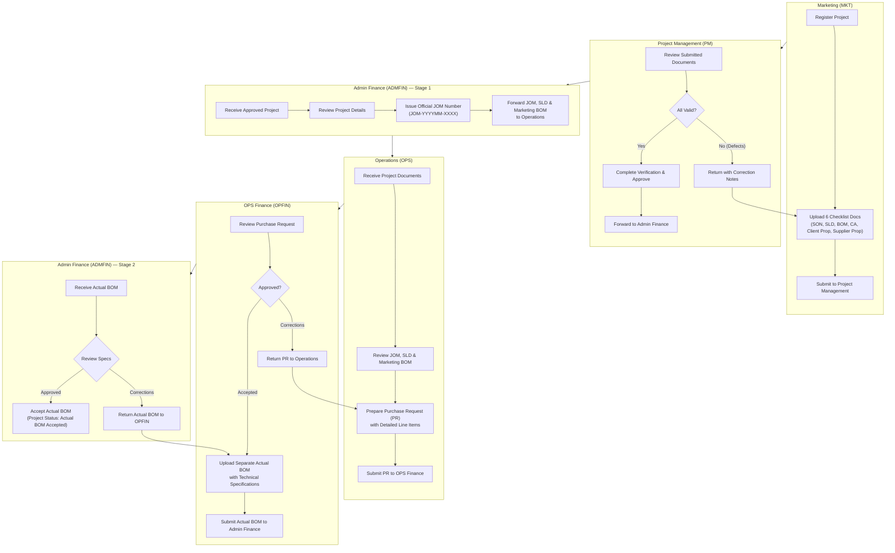
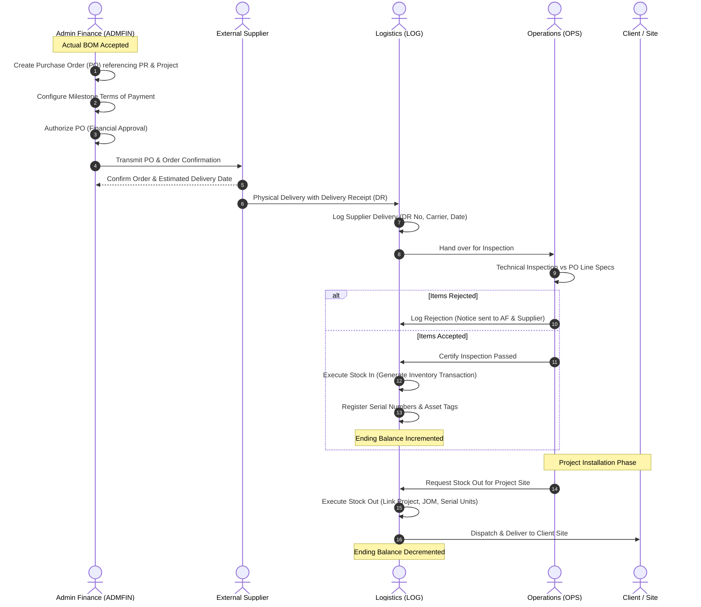
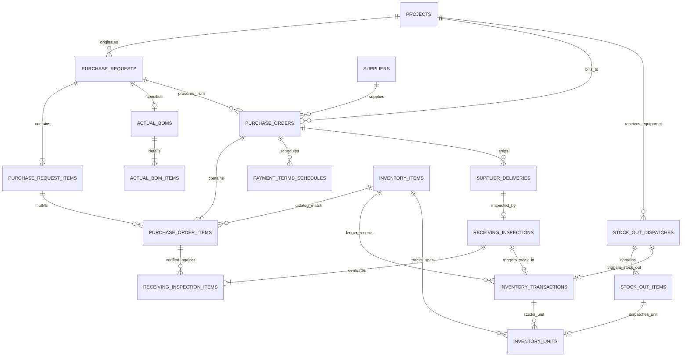
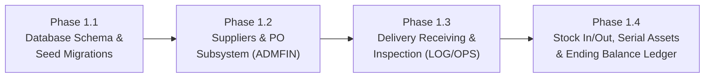

# OPERATIONS INTEGRATION PLAN: PURCHASING, SUPPLIER RECEIVING & INVENTORY TRACKING

**Document Status:** Architecture & Integration Blueprint (Phase 1 Deliverable)  
**Target System:** Pagecom Inc. / SYB Business Management System (BMS)  
**Tech Stack:** Native PHP 8.2+, MySQL / MariaDB (InnoDB, utf8mb4), PDO, Bootstrap 5, Custom Lightweight MVC  
**Base Directory:** `c:\xampp\htdocs\BMS`  
**Date:** November 2026  

---

## Executive Summary

The Business Management System (BMS) currently implements an authenticated multi-department project governance workflow:
$$\text{MARKETING} \longrightarrow \text{PROJECT MANAGEMENT} \longrightarrow \text{ADMIN FINANCE} \longrightarrow \text{OPERATIONS} \longrightarrow \text{OPS FINANCE} \longrightarrow \text{ADMIN FINANCE}$$

Under this confirmed baseline, **Marketing** registers projects with 6 mandatory documents; **Project Management (PM)** verifies compliance without issuing JOM numbers; **Admin Finance (ADMFIN)** holds sole authority for generating unique Job Order Memorandum (JOM) numbers and forwarding JOM, SLD, and Marketing BOM to **Operations (OPS)**; **Operations** prepares Purchase Requests (PRs) with line items; **OPS Finance (OPFIN)** uploads technical Actual BOMs with specifications; and **Admin Finance** accepts the Actual BOM package.

This blueprint outlines the architectural integration for the downstream **Purchasing and Inventory Workflow**:
$$\begin{aligned}
\text{PR Creation} &\longrightarrow \text{PR Review \& Approval} \longrightarrow \text{PO Creation \& Authorization} \longrightarrow \text{Terms of Payment} \\
&\longrightarrow \text{Supplier Order} \longrightarrow \text{Supplier Delivery} \longrightarrow \text{Receiving \& Inspection} \\
&\longrightarrow \text{Stock In} \longrightarrow \text{Inventory Tracking} \longrightarrow \text{Stock Out} \longrightarrow \text{Ending Balance}
\end{aligned}$$

Crucially, this lifecycle spans multiple departments (**Admin Finance**, **Operations**, and **Logistics**) rather than residing entirely within Operations. This document provides the complete audit findings, database schema designs, role permissions, module blueprints, and phased rollout sequence.

---

## 1. Existing Operations Architecture

### 1.1 Controllers & Endpoints
* **Controller Class:** [`App\Controllers\OperationsController`](file:///c:/xampp/htdocs/BMS/app/Controllers/OperationsController.php)
  * `dashboard(Request $request)`: Renders [`app/Views/operations/dashboard.php`](file:///c:/xampp/htdocs/BMS/app/Views/operations/dashboard.php) with 4 real-time database metric cards, search query filters (`q`), status filters (`status`), sorting (`sort`), and 10-record pagination.
  * `projects(Request $request)`: Renders [`app/Views/operations/projects.php`](file:///c:/xampp/htdocs/BMS/app/Views/operations/projects.php) listing all incoming forwarded projects.
  * `savePurchaseRequest(Request $request, array $params)`: Validates and persists Draft PR records with line items and optional file attachments. Supports direct one-click submission to OPS Finance.
  * `submitPurchaseRequest(Request $request, array $params)`: Finalizes and submits a drafted/returned PR to OPS Finance.
* **Registered Web Routes** ([`routes/web.php`](file:///c:/xampp/htdocs/BMS/routes/web.php)):
  * `GET  /operations/dashboard`
  * `GET  /operations/projects`
  * `POST /projects/{id}/purchase-request`
  * `POST /projects/{id}/purchase-request/submit`

### 1.2 Data Models & Service Layer
* **Model:** [`App\Models\PurchaseRequest`](file:///c:/xampp/htdocs/BMS/app/Models/PurchaseRequest.php)
  * Enforces state machine statuses: `Draft`, `Submitted to OPS Finance`, `Under OPS Finance Review`, `Returned for Corrections`.
  * Manages one-to-many relationship with line items in `purchase_request_items`.
  * Provides SQL query aggregation for Operations dashboard metric cards.
* **Service:** [`App\Services\PurchaseRequestService`](file:///c:/xampp/htdocs/BMS/app/Services/PurchaseRequestService.php)
  * Generates sequential PR numbers using format `PR-{YEAR}{MONTH}-{SEQ}` (configurable via `config/pm.php`).
  * Enforces database transactions (`PDO::beginTransaction` / `commit` / `rollBack`) across `purchase_requests`, `purchase_request_items`, and document attachments.
  * Emits notifications to OPS Finance and logs actions to `activity_logs` and `project_workflow_histories`.

### 1.3 Access Control & Document Boundaries
* **Authorization Service:** [`App\Services\AuthorizationService`](file:///c:/xampp/htdocs/BMS/app/Services/AuthorizationService.php)
  * `isOperationsUser($user)`: Validates user department code is `OPS`.
  * `canPreparePurchaseRequest($user, $project, $existingPr)`: Verifies user is active OPS user/Admin, project is forwarded to Operations (`verification_status = 'forwarded_to_operations'`), JOM number is non-empty, and PR is in an editable status (`Draft` or `Returned for Corrections`).
  * `canDownloadDocument($user, $project, $document)`: Strictly limits Operations users to viewing/downloading **only** the `SLD`, `BOM` (Marketing BOM), and PR attachments (`DOC_TYPE_ATTACHMENT`). All other pre-contract documents (SON, CA, Client Proposal, Supplier Proposal) remain access-restricted.

---

## 2. Existing Purchasing & Inventory Functionality (Audit Findings)

A comprehensive inspection of the database schema, models, services, views, and routes reveals the current state:

| Subsystem / Capability | Current Status | Audit Finding |
| :--- | :---: | :--- |
| **Purchase Requests (PR)** | **Implemented** | Structured PRs with multiple line items (`purchase_requests`, `purchase_request_items`) exist. Operations authors PRs; OPS Finance reviews and returns/accepts. |
| **Actual BOM with Specs** | **Implemented** | OPS Finance creates Actual BOM with technical specifications (`actual_boms`, `actual_bom_items`). Admin Finance reviews, receives, and accepts. |
| **Purchase Orders (PO)** | **Missing (0%)** | No PO tables, models, controllers, routes, or views exist. Admin Finance currently stops at "Actual BOM Accepted". |
| **Terms of Payment** | **Missing (0%)** | No payment terms scheduling, milestone configuration, or disbursement tracking exists. |
| **Supplier Directory** | **Missing (0%)** | No `suppliers` table or vendor registry exists. Marketing uploads a static "Proposal from Supplier" PDF, but structured vendor entities are absent. |
| **Supplier Delivery / DR** | **Missing (0%)** | No delivery receipt tracking, carrier logging, or receiving records exist. |
| **Receiving & Inspection** | **Missing (0%)** | No technical QA/QC inspection or delivery acceptance/rejection logging exists. |
| **Stock In / Warehousing** | **Missing (0%)** | No stock intake ledger or warehouse location tracking exists. |
| **Serialized Assets** | **Missing (0%)** | No equipment tracking by serial number, asset tag, barcode, or deployment status exists. |
| **Stock Out / Dispatch** | **Missing (0%)** | No dispatch records linking warehouse stock to project sites or client installations exist. |
| **Inventory Balance** | **Missing (0%)** | No perpetual inventory ledger ($Ending = Opening + In - Out$) exists. |

---

## 3. Current Workflow and Department Handoffs

### 3.1 Implemented Upstream Lifecycle


### 3.2 Target Purchasing & Downstream Inventory Chain
Following Admin Finance's acceptance of the Actual BOM, the system must hand off to the integrated purchasing and materials control chain:



---

## 4. Missing Functionality & Gap Analysis

To bridge the current state to the full company requirements, 7 major functional subsystems must be introduced into the existing BMS:

1. **Vendor Directory Subsystem (`suppliers`):**
   * Registry for approved vendors, contacts, tax numbers, bank details, and default credit terms.
   * Scoped to Admin Finance, Logistics, and Administrators.
2. **Purchase Order Subsystem (`purchase_orders`, `purchase_order_items`):**
   * Generation of official POs (`PO-YYYYMM-XXXX`) directly derived from approved PR items and accepted Actual BOM specifications.
   * Multi-currency support, tax computations, delivery address, and authorized signature capture.
   * Owned exclusively by **Admin Finance**.
3. **Payment Terms Subsystem (`payment_terms_schedules`):**
   * Structured payment milestone schedule attached to each PO (e.g., 20% downpayment upon PO issuance, 70% upon delivery receipt, 10% retention upon testing/commissioning).
   * Tracked and disbursed by **Admin Finance**.
4. **Supplier Delivery & DR Subsystem (`supplier_deliveries`):**
   * Intake logging of supplier shipments matching against PO numbers.
   * Tracking carrier, waybill, delivery receipt (DR) document scans, and physical arrival timestamp.
   * Owned by **Logistics** (`LOG`) and **Operations** (`OPS`).
5. **Quality Receiving & Technical Inspection Subsystem (`receiving_inspections`, `receiving_inspection_items`):**
   * Line-by-line inspection comparing delivered physical items against PO technical specifications.
   * Quantitative recording: `quantity_delivered`, `quantity_accepted`, `quantity_rejected`, and `rejection_reason`.
   * Owned by **Operations** (technical evaluation) and **Logistics**.
6. **Perpetual Inventory Ledger Subsystem (`inventory_transactions`, `inventory_items`):**
   * Double-entry ledger recording all material movements: `stock_in`, `stock_out`, `transfer`, `adjustment`.
   * Calculation of real-time item balances per location:
     $$\text{Ending Balance} = \text{Opening Balance} + \sum \text{Stock In} - \sum \text{Stock Out} \pm \sum \text{Adjustments}$$
   * Automated update of running balances within strict database transactions.
7. **Serialized Equipment Tracking Subsystem (`inventory_units`):**
   * Unique tracking for high-value equipment units (inverters, solar panels, transformers, controllers).
   * Tracks serial number, barcode, asset tag, warranty expiry, status (`In Stock`, `Allocated`, `Dispatched`, `Defective/RMA`), and exact physical location.
   * Stock Out transactions must link specific serial numbers to the project JOM and receiving client.

---

## 5. Required Database Relationships (ER Architecture)

### 5.1 Entity Relationship Diagram



### 5.2 Proposed Tables & Schema Specification

#### 1. `suppliers`
Vendor master registry managed by Admin Finance and Logistics.
```sql
CREATE TABLE IF NOT EXISTS `suppliers` (
    `id` INT UNSIGNED NOT NULL AUTO_INCREMENT,
    `supplier_code` VARCHAR(50) NOT NULL,
    `supplier_name` VARCHAR(200) NOT NULL,
    `contact_person` VARCHAR(150) NULL,
    `email` VARCHAR(190) NULL,
    `phone` VARCHAR(50) NULL,
    `address` TEXT NULL,
    `tax_identification_number` VARCHAR(50) NULL,
    `default_payment_terms` VARCHAR(100) NULL DEFAULT 'Net 30',
    `status` VARCHAR(20) NOT NULL DEFAULT 'active',
    `created_by` INT UNSIGNED NOT NULL,
    `created_at` DATETIME NOT NULL DEFAULT CURRENT_TIMESTAMP,
    `updated_at` DATETIME NOT NULL DEFAULT CURRENT_TIMESTAMP ON UPDATE CURRENT_TIMESTAMP,
    PRIMARY KEY (`id`),
    UNIQUE KEY `uq_suppliers_code` (`supplier_code`),
    KEY `idx_suppliers_status` (`status`),
    CONSTRAINT `fk_suppliers_created_by` FOREIGN KEY (`created_by`) REFERENCES `users` (`id`)
) ENGINE=InnoDB DEFAULT CHARSET=utf8mb4 COLLATE=utf8mb4_unicode_ci;
```

#### 2. `purchase_orders`
Official PO issued by Admin Finance, referencing an approved PR and accepted Actual BOM.
```sql
CREATE TABLE IF NOT EXISTS `purchase_orders` (
    `id` INT UNSIGNED NOT NULL AUTO_INCREMENT,
    `po_number` VARCHAR(60) NOT NULL,
    `purchase_request_id` INT UNSIGNED NOT NULL,
    `project_id` INT UNSIGNED NOT NULL,
    `jom_number` VARCHAR(50) NOT NULL,
    `supplier_id` INT UNSIGNED NOT NULL,
    `po_date` DATE NOT NULL,
    `expected_delivery_date` DATE NULL,
    `payment_terms_summary` VARCHAR(255) NULL,
    `currency` VARCHAR(10) NOT NULL DEFAULT 'PHP',
    `subtotal_amount` DECIMAL(15,2) NOT NULL DEFAULT 0.00,
    `tax_amount` DECIMAL(15,2) NOT NULL DEFAULT 0.00,
    `total_amount` DECIMAL(15,2) NOT NULL DEFAULT 0.00,
    `remarks` TEXT NULL,
    `status` VARCHAR(60) NOT NULL DEFAULT 'Draft',
    `created_by` INT UNSIGNED NOT NULL,
    `authorized_by` INT UNSIGNED NULL,
    `authorized_at` DATETIME NULL,
    `sent_to_supplier_at` DATETIME NULL,
    `created_at` DATETIME NOT NULL DEFAULT CURRENT_TIMESTAMP,
    `updated_at` DATETIME NOT NULL DEFAULT CURRENT_TIMESTAMP ON UPDATE CURRENT_TIMESTAMP,
    PRIMARY KEY (`id`),
    UNIQUE KEY `uq_po_number` (`po_number`),
    KEY `idx_po_project` (`project_id`),
    KEY `idx_po_pr` (`purchase_request_id`),
    KEY `idx_po_supplier` (`supplier_id`),
    KEY `idx_po_status` (`status`),
    CONSTRAINT `fk_po_pr` FOREIGN KEY (`purchase_request_id`) REFERENCES `purchase_requests` (`id`),
    CONSTRAINT `fk_po_project` FOREIGN KEY (`project_id`) REFERENCES `projects` (`id`),
    CONSTRAINT `fk_po_supplier` FOREIGN KEY (`supplier_id`) REFERENCES `suppliers` (`id`),
    CONSTRAINT `fk_po_created_by` FOREIGN KEY (`created_by`) REFERENCES `users` (`id`),
    CONSTRAINT `fk_po_authorized_by` FOREIGN KEY (`authorized_by`) REFERENCES `users` (`id`)
) ENGINE=InnoDB DEFAULT CHARSET=utf8mb4 COLLATE=utf8mb4_unicode_ci;
```

#### 3. `purchase_order_items`
Individual line items on the PO, linked back to the PR items.
```sql
CREATE TABLE IF NOT EXISTS `purchase_order_items` (
    `id` INT UNSIGNED NOT NULL AUTO_INCREMENT,
    `purchase_order_id` INT UNSIGNED NOT NULL,
    `pr_item_id` INT UNSIGNED NULL,
    `line_no` INT UNSIGNED NOT NULL DEFAULT 1,
    `item_description` VARCHAR(255) NOT NULL,
    `item_specification` TEXT NOT NULL,
    `quantity_ordered` DECIMAL(12,2) NOT NULL DEFAULT 1.00,
    `unit_of_measure` VARCHAR(50) NOT NULL DEFAULT 'pcs',
    `unit_price` DECIMAL(15,2) NOT NULL DEFAULT 0.00,
    `total_price` DECIMAL(15,2) NOT NULL DEFAULT 0.00,
    `remarks` VARCHAR(500) NULL,
    `created_at` DATETIME NOT NULL DEFAULT CURRENT_TIMESTAMP,
    PRIMARY KEY (`id`),
    KEY `idx_poi_po_id` (`purchase_order_id`, `line_no`),
    CONSTRAINT `fk_poi_po` FOREIGN KEY (`purchase_order_id`) REFERENCES `purchase_orders` (`id`) ON DELETE CASCADE,
    CONSTRAINT `fk_poi_pr_item` FOREIGN KEY (`pr_item_id`) REFERENCES `purchase_request_items` (`id`) ON DELETE SET NULL
) ENGINE=InnoDB DEFAULT CHARSET=utf8mb4 COLLATE=utf8mb4_unicode_ci;
```

#### 4. `payment_terms_schedules`
Milestone-based payment schedules authorized by Admin Finance.
```sql
CREATE TABLE IF NOT EXISTS `payment_terms_schedules` (
    `id` INT UNSIGNED NOT NULL AUTO_INCREMENT,
    `purchase_order_id` INT UNSIGNED NOT NULL,
    `milestone_name` VARCHAR(150) NOT NULL,
    `percentage` DECIMAL(5,2) NOT NULL DEFAULT 0.00,
    `amount` DECIMAL(15,2) NOT NULL DEFAULT 0.00,
    `condition_type` VARCHAR(80) NOT NULL, -- 'Upon PO Issuance', 'Upon Delivery (DR)', 'Upon Acceptance', 'Net Days'
    `due_date` DATE NULL,
    `status` VARCHAR(40) NOT NULL DEFAULT 'Scheduled', -- 'Scheduled', 'Due', 'Paid', 'Cancelled'
    `payment_reference` VARCHAR(100) NULL,
    `paid_at` DATETIME NULL,
    `paid_by` INT UNSIGNED NULL,
    `notes` TEXT NULL,
    PRIMARY KEY (`id`),
    KEY `idx_pts_po` (`purchase_order_id`),
    CONSTRAINT `fk_pts_po` FOREIGN KEY (`purchase_order_id`) REFERENCES `purchase_orders` (`id`) ON DELETE CASCADE,
    CONSTRAINT `fk_pts_paid_by` FOREIGN KEY (`paid_by`) REFERENCES `users` (`id`) ON DELETE SET NULL
) ENGINE=InnoDB DEFAULT CHARSET=utf8mb4 COLLATE=utf8mb4_unicode_ci;
```

#### 5. `supplier_deliveries`
Physical shipments received from suppliers.
```sql
CREATE TABLE IF NOT EXISTS `supplier_deliveries` (
    `id` INT UNSIGNED NOT NULL AUTO_INCREMENT,
    `delivery_receipt_no` VARCHAR(100) NOT NULL,
    `purchase_order_id` INT UNSIGNED NOT NULL,
    `project_id` INT UNSIGNED NOT NULL,
    `supplier_id` INT UNSIGNED NOT NULL,
    `carrier_name` VARCHAR(150) NULL,
    `tracking_or_plate_no` VARCHAR(100) NULL,
    `delivery_date` DATE NOT NULL,
    `dr_document_id` INT UNSIGNED NULL,
    `received_by` INT UNSIGNED NOT NULL,
    `receiving_notes` TEXT NULL,
    `status` VARCHAR(50) NOT NULL DEFAULT 'Pending Inspection', -- 'Pending Inspection', 'Inspected', 'Stocked In', 'Discrepancy'
    `created_at` DATETIME NOT NULL DEFAULT CURRENT_TIMESTAMP,
    PRIMARY KEY (`id`),
    KEY `idx_sd_po` (`purchase_order_id`),
    KEY `idx_sd_dr_no` (`delivery_receipt_no`),
    CONSTRAINT `fk_sd_po` FOREIGN KEY (`purchase_order_id`) REFERENCES `purchase_orders` (`id`),
    CONSTRAINT `fk_sd_project` FOREIGN KEY (`project_id`) REFERENCES `projects` (`id`),
    CONSTRAINT `fk_sd_supplier` FOREIGN KEY (`supplier_id`) REFERENCES `suppliers` (`id`),
    CONSTRAINT `fk_sd_received_by` FOREIGN KEY (`received_by`) REFERENCES `users` (`id`),
    CONSTRAINT `fk_sd_doc` FOREIGN KEY (`dr_document_id`) REFERENCES `project_documents` (`id`) ON DELETE SET NULL
) ENGINE=InnoDB DEFAULT CHARSET=utf8mb4 COLLATE=utf8mb4_unicode_ci;
```

#### 6. `receiving_inspections` & `receiving_inspection_items`
Technical evaluation by Operations comparing delivered goods with PO specifications.
```sql
CREATE TABLE IF NOT EXISTS `receiving_inspections` (
    `id` INT UNSIGNED NOT NULL AUTO_INCREMENT,
    `delivery_id` INT UNSIGNED NOT NULL,
    `purchase_order_id` INT UNSIGNED NOT NULL,
    `inspected_by` INT UNSIGNED NOT NULL,
    `inspection_date` DATETIME NOT NULL DEFAULT CURRENT_TIMESTAMP,
    `inspection_result` VARCHAR(40) NOT NULL DEFAULT 'Passed', -- 'Passed', 'Partial Pass', 'Rejected'
    `inspection_notes` TEXT NULL,
    `inspection_report_doc_id` INT UNSIGNED NULL,
    `created_at` DATETIME NOT NULL DEFAULT CURRENT_TIMESTAMP,
    PRIMARY KEY (`id`),
    KEY `idx_ri_delivery` (`delivery_id`),
    KEY `idx_ri_po` (`purchase_order_id`),
    CONSTRAINT `fk_ri_delivery` FOREIGN KEY (`delivery_id`) REFERENCES `supplier_deliveries` (`id`) ON DELETE CASCADE,
    CONSTRAINT `fk_ri_po` FOREIGN KEY (`purchase_order_id`) REFERENCES `purchase_orders` (`id`),
    CONSTRAINT `fk_ri_inspected_by` FOREIGN KEY (`inspected_by`) REFERENCES `users` (`id`),
    CONSTRAINT `fk_ri_doc` FOREIGN KEY (`inspection_report_doc_id`) REFERENCES `project_documents` (`id`) ON DELETE SET NULL
) ENGINE=InnoDB DEFAULT CHARSET=utf8mb4 COLLATE=utf8mb4_unicode_ci;

CREATE TABLE IF NOT EXISTS `receiving_inspection_items` (
    `id` INT UNSIGNED NOT NULL AUTO_INCREMENT,
    `inspection_id` INT UNSIGNED NOT NULL,
    `po_item_id` INT UNSIGNED NOT NULL,
    `quantity_delivered` DECIMAL(12,2) NOT NULL,
    `quantity_accepted` DECIMAL(12,2) NOT NULL,
    `quantity_rejected` DECIMAL(12,2) NOT NULL DEFAULT 0.00,
    `rejection_reason` VARCHAR(500) NULL,
    PRIMARY KEY (`id`),
    KEY `idx_rii_inspection` (`inspection_id`),
    CONSTRAINT `fk_rii_inspection` FOREIGN KEY (`inspection_id`) REFERENCES `receiving_inspections` (`id`) ON DELETE CASCADE,
    CONSTRAINT `fk_rii_po_item` FOREIGN KEY (`po_item_id`) REFERENCES `purchase_order_items` (`id`)
) ENGINE=InnoDB DEFAULT CHARSET=utf8mb4 COLLATE=utf8mb4_unicode_ci;
```

#### 7. `inventory_items`
Master catalog of materials and equipment tracked in inventory.
```sql
CREATE TABLE IF NOT EXISTS `inventory_items` (
    `id` INT UNSIGNED NOT NULL AUTO_INCREMENT,
    `item_code` VARCHAR(50) NOT NULL,
    `item_name` VARCHAR(200) NOT NULL,
    `category` VARCHAR(60) NOT NULL DEFAULT 'Serialized Equipment', -- 'Serialized Equipment', 'Bulk Material', 'Consumable'
    `unit_of_measure` VARCHAR(50) NOT NULL DEFAULT 'pcs',
    `is_serialized` TINYINT(1) NOT NULL DEFAULT 1,
    `reorder_level` DECIMAL(12,2) NOT NULL DEFAULT 0.00,
    `current_balance` DECIMAL(12,2) NOT NULL DEFAULT 0.00,
    `description` TEXT NULL,
    `status` VARCHAR(20) NOT NULL DEFAULT 'active',
    `created_at` DATETIME NOT NULL DEFAULT CURRENT_TIMESTAMP,
    `updated_at` DATETIME NOT NULL DEFAULT CURRENT_TIMESTAMP ON UPDATE CURRENT_TIMESTAMP,
    PRIMARY KEY (`id`),
    UNIQUE KEY `uq_inventory_item_code` (`item_code`),
    KEY `idx_inventory_category` (`category`)
) ENGINE=InnoDB DEFAULT CHARSET=utf8mb4 COLLATE=utf8mb4_unicode_ci;
```

#### 8. `inventory_transactions`
Perpetual double-entry inventory ledger calculating live balances.
```sql
CREATE TABLE IF NOT EXISTS `inventory_transactions` (
    `id` BIGINT UNSIGNED NOT NULL AUTO_INCREMENT,
    `transaction_number` VARCHAR(60) NOT NULL,
    `transaction_type` VARCHAR(40) NOT NULL, -- 'stock_in', 'stock_out', 'transfer', 'adjustment'
    `inventory_item_id` INT UNSIGNED NOT NULL,
    `quantity` DECIMAL(12,2) NOT NULL,
    `unit_of_measure` VARCHAR(50) NOT NULL,
    `warehouse_location` VARCHAR(100) NOT NULL DEFAULT 'Main Warehouse',
    `project_id` INT UNSIGNED NULL,
    `jom_number` VARCHAR(50) NULL,
    `reference_type` VARCHAR(60) NOT NULL, -- 'po_delivery', 'inspection', 'stock_out_dispatch', 'adjustment'
    `reference_id` INT UNSIGNED NOT NULL,
    `balance_before` DECIMAL(12,2) NOT NULL,
    `balance_after` DECIMAL(12,2) NOT NULL,
    `performed_by` INT UNSIGNED NOT NULL,
    `remarks` VARCHAR(500) NULL,
    `created_at` DATETIME NOT NULL DEFAULT CURRENT_TIMESTAMP,
    PRIMARY KEY (`id`),
    UNIQUE KEY `uq_inv_trans_number` (`transaction_number`),
    KEY `idx_inv_trans_item` (`inventory_item_id`, `created_at`),
    KEY `idx_inv_trans_project` (`project_id`),
    KEY `idx_inv_trans_ref` (`reference_type`, `reference_id`),
    CONSTRAINT `fk_it_item` FOREIGN KEY (`inventory_item_id`) REFERENCES `inventory_items` (`id`),
    CONSTRAINT `fk_it_project` FOREIGN KEY (`project_id`) REFERENCES `projects` (`id`) ON DELETE SET NULL,
    CONSTRAINT `fk_it_user` FOREIGN KEY (`performed_by`) REFERENCES `users` (`id`)
) ENGINE=InnoDB DEFAULT CHARSET=utf8mb4 COLLATE=utf8mb4_unicode_ci;
```

#### 9. `inventory_units`
Individual serialized asset units with real-time lifecycle tracking.
```sql
CREATE TABLE IF NOT EXISTS `inventory_units` (
    `id` INT UNSIGNED NOT NULL AUTO_INCREMENT,
    `inventory_item_id` INT UNSIGNED NOT NULL,
    `serial_number` VARCHAR(150) NOT NULL,
    `asset_tag` VARCHAR(100) NULL,
    `barcode` VARCHAR(100) NULL,
    `purchase_order_id` INT UNSIGNED NOT NULL,
    `delivery_id` INT UNSIGNED NOT NULL,
    `stock_in_transaction_id` BIGINT UNSIGNED NOT NULL,
    `status` VARCHAR(50) NOT NULL DEFAULT 'In Stock', -- 'In Stock', 'Reserved', 'Dispatched to Site', 'Installed / Commissioned', 'Defective / RMA', 'Disposed'
    `current_location` VARCHAR(150) NOT NULL DEFAULT 'Main Warehouse',
    `project_id` INT UNSIGNED NULL,
    `jom_number` VARCHAR(50) NULL,
    `dispatched_to_client` VARCHAR(150) NULL,
    `dispatched_at` DATETIME NULL,
    `warranty_expires_at` DATE NULL,
    `created_at` DATETIME NOT NULL DEFAULT CURRENT_TIMESTAMP,
    `updated_at` DATETIME NOT NULL DEFAULT CURRENT_TIMESTAMP ON UPDATE CURRENT_TIMESTAMP,
    PRIMARY KEY (`id`),
    UNIQUE KEY `uq_unit_item_serial` (`inventory_item_id`, `serial_number`),
    KEY `idx_iu_status` (`status`),
    KEY `idx_iu_project` (`project_id`),
    CONSTRAINT `fk_iu_item` FOREIGN KEY (`inventory_item_id`) REFERENCES `inventory_items` (`id`),
    CONSTRAINT `fk_iu_po` FOREIGN KEY (`purchase_order_id`) REFERENCES `purchase_orders` (`id`),
    CONSTRAINT `fk_iu_delivery` FOREIGN KEY (`delivery_id`) REFERENCES `supplier_deliveries` (`id`),
    CONSTRAINT `fk_iu_trans` FOREIGN KEY (`stock_in_transaction_id`) REFERENCES `inventory_transactions` (`id`),
    CONSTRAINT `fk_iu_project` FOREIGN KEY (`project_id`) REFERENCES `projects` (`id`) ON DELETE SET NULL
) ENGINE=InnoDB DEFAULT CHARSET=utf8mb4 COLLATE=utf8mb4_unicode_ci;
```

#### 10. `stock_out_dispatches` & `stock_out_items`
Official release of equipment and materials to project sites and clients.
```sql
CREATE TABLE IF NOT EXISTS `stock_out_dispatches` (
    `id` INT UNSIGNED NOT NULL AUTO_INCREMENT,
    `dispatch_number` VARCHAR(60) NOT NULL,
    `project_id` INT UNSIGNED NOT NULL,
    `jom_number` VARCHAR(50) NOT NULL,
    `destination_site` VARCHAR(255) NOT NULL,
    `receiving_client` VARCHAR(150) NOT NULL,
    `receiving_contact` VARCHAR(150) NULL,
    `dispatched_by` INT UNSIGNED NOT NULL,
    `dispatch_date` DATE NOT NULL,
    `delivery_receipt_doc_id` INT UNSIGNED NULL,
    `status` VARCHAR(40) NOT NULL DEFAULT 'Dispatched', -- 'Draft', 'Approved', 'Dispatched', 'Confirmed Installed'
    `notes` TEXT NULL,
    `created_at` DATETIME NOT NULL DEFAULT CURRENT_TIMESTAMP,
    PRIMARY KEY (`id`),
    UNIQUE KEY `uq_dispatch_number` (`dispatch_number`),
    KEY `idx_sod_project` (`project_id`),
    CONSTRAINT `fk_sod_project` FOREIGN KEY (`project_id`) REFERENCES `projects` (`id`),
    CONSTRAINT `fk_sod_user` FOREIGN KEY (`dispatched_by`) REFERENCES `users` (`id`),
    CONSTRAINT `fk_sod_doc` FOREIGN KEY (`delivery_receipt_doc_id`) REFERENCES `project_documents` (`id`) ON DELETE SET NULL
) ENGINE=InnoDB DEFAULT CHARSET=utf8mb4 COLLATE=utf8mb4_unicode_ci;

CREATE TABLE IF NOT EXISTS `stock_out_items` (
    `id` INT UNSIGNED NOT NULL AUTO_INCREMENT,
    `dispatch_id` INT UNSIGNED NOT NULL,
    `inventory_item_id` INT UNSIGNED NOT NULL,
    `inventory_unit_id` INT UNSIGNED NULL, -- Non-null for serialized assets
    `quantity` DECIMAL(12,2) NOT NULL DEFAULT 1.00,
    `unit_of_measure` VARCHAR(50) NOT NULL DEFAULT 'pcs',
    `remarks` VARCHAR(255) NULL,
    PRIMARY KEY (`id`),
    KEY `idx_soi_dispatch` (`dispatch_id`),
    CONSTRAINT `fk_soi_dispatch` FOREIGN KEY (`dispatch_id`) REFERENCES `stock_out_dispatches` (`id`) ON DELETE CASCADE,
    CONSTRAINT `fk_soi_item` FOREIGN KEY (`inventory_item_id`) REFERENCES `inventory_items` (`id`),
    CONSTRAINT `fk_soi_unit` FOREIGN KEY (`inventory_unit_id`) REFERENCES `inventory_units` (`id`) ON DELETE SET NULL
) ENGINE=InnoDB DEFAULT CHARSET=utf8mb4 COLLATE=utf8mb4_unicode_ci;
```

---

## 6. Recommended Module Structure

Integrating cleanly into the existing MVC layout without creating an isolated application requires adding the following controllers, models, services, and views:

```
c:\xampp\htdocs\BMS\
├── app\
│   ├── Controllers\
│   │   ├── SupplierController.php          # Supplier directory & terms management
│   │   ├── PurchaseOrderController.php     # Admin Finance PO generation & authorization
│   │   ├── ReceivingController.php         # Logistics & Operations delivery arrivals
│   │   ├── InspectionController.php        # Operations technical receiving inspection
│   │   └── InventoryController.php         # Stock in, stock out, serialized units & balance ledger
│   ├── Models\
│   │   ├── Supplier.php                    # Vendor entity & validations
│   │   ├── PurchaseOrder.php               # PO state machine & line items
│   │   ├── PurchaseOrderItem.php           # Line item computations
│   │   ├── PaymentTermSchedule.php         # Milestone payment status & disbursements
│   │   ├── SupplierDelivery.php            # Delivery receipts & status tracking
│   │   ├── ReceivingInspection.php         # Technical inspection records & QA/QC
│   │   ├── ReceivingInspectionItem.php     # Line-by-line inspection accepted/rejected counts
│   │   ├── InventoryItem.php               # Catalog & reorder thresholds
│   │   ├── InventoryTransaction.php        # Immutable double-entry inventory ledger
│   │   ├── InventoryUnit.php               # Serialized asset records & barcode/location tracking
│   │   ├── StockOutDispatch.php            # Site dispatch vouchers
│   │   └── StockOutItem.php                # Dispatched items & serialized links
│   ├── Services\
│   │   ├── SupplierService.php             # Vendor onboarding & audit checks
│   │   ├── PurchaseOrderService.php        # Number generation (PO-YYYYMM-XXXX), item copy from PR
│   │   ├── ReceivingInspectionService.php  # Inspection workflow & discrepancy handling
│   │   └── InventoryLedgerService.php      # Transactional stock in/out, serialization, ending balance math
│   └── Views\
│       ├── suppliers\
│       │   ├── index.php                   # Supplier directory table
│       │   ├── create.php                  # Add new vendor form
│       │   └── edit.php                    # Edit vendor details
│       ├── purchase_orders\
│       │   ├── index.php                   # Admin Finance PO queue & statuses
│       │   ├── create.php                  # Draft PO from approved PR & Actual BOM
│       │   ├── show.php                    # PO summary, line items, and payment terms schedule
│       │   └── pdf_view.php                # Official printable PO document layout
│       ├── receiving\
│       │   ├── index.php                   # Logistics incoming deliveries queue
│       │   ├── create.php                  # Log incoming delivery with DR number
│       │   └── inspect.php                 # Operations line-by-line technical inspection form
│       └── inventory\
│           ├── dashboard.php               # Inventory overview, stock values, reorder alerts
│           ├── items.php                   # Item master catalog table with ending balances
│           ├── serialized.php              # Serialized units tracking table with filter/search
│           ├── stock_in.php                # Stock in form linked to inspection
│           ├── stock_out.php               # Stock out release voucher to project/client
│           └── ledger.php                  # Full immutable transaction audit trail
```

---

## 7. Required Permission Changes & RBAC Mapping

The database schema already provides the 6 designated departments (`MKT`, `PM`, `OPS`, `LOG`, `OPFIN`, `ADMFIN`) and the granular permissions table `permissions`. The following 14 permissions must be added to `permissions` and associated with roles:

```sql
INSERT INTO `permissions` (`permission_key`, `permission_name`, `module_group`, `description`)
VALUES
    -- Suppliers
    ('suppliers.view', 'View Supplier Directory', 'Procurement', 'View registered vendor accounts and payment terms.'),
    ('suppliers.manage', 'Manage Suppliers', 'Procurement', 'Create and edit vendor details, terms, and tax records.'),

    -- Purchase Orders (Admin Finance Authority)
    ('po.view', 'View Purchase Orders', 'Procurement', 'Inspect Purchase Orders across projects.'),
    ('po.create', 'Create Draft Purchase Orders', 'Procurement', 'Prepare POs derived from approved PRs and accepted Actual BOMs.'),
    ('po.authorize', 'Authorize Purchase Orders', 'Procurement', 'Officially authorize POs for supplier transmission (Admin Finance only).'),
    ('po.send_supplier', 'Send PO to Supplier', 'Procurement', 'Transmit authorized PO and terms to the vendor.'),
    ('po.payment_terms', 'Manage Terms of Payment', 'Procurement', 'Configure and disburse PO milestone payment schedules.'),

    -- Supplier Delivery & Receiving (Logistics & Operations)
    ('deliveries.view', 'View Supplier Deliveries', 'Logistics', 'Inspect incoming shipment receipts and waybills.'),
    ('deliveries.receive', 'Receive Supplier Delivery', 'Logistics', 'Log arriving shipments and Delivery Receipt (DR) vouchers.'),

    -- Technical Inspection (Operations Authority)
    ('inspections.perform', 'Perform Technical Inspection', 'Operations', 'Perform technical QA/QC inspection and record accepted/rejected quantities.'),

    -- Inventory & Warehousing (Logistics & Operations)
    ('inventory.view', 'View Inventory & Balances', 'Inventory', 'View master item catalog, stock levels, and ending balances.'),
    ('inventory.stock_in', 'Execute Stock In', 'Inventory', 'Stock in accepted inspected goods and register serial numbers.'),
    ('inventory.track_units', 'Track Serialized Units', 'Inventory', 'Manage serial numbers, asset tags, barcodes, and unit conditions.'),
    ('inventory.stock_out', 'Execute Stock Out', 'Inventory', 'Dispatch equipment to designated project sites and clients.');
```

### Department-to-Permission Matrix

| Permission Key | Admin | Admin Finance (`ADMFIN`) | Operations (`OPS`) | Logistics (`LOG`) | OPS Finance (`OPFIN`) | Project Mgmt (`PM`) |
| :--- | :---: | :---: | :---: | :---: | :---: | :---: |
| `suppliers.view` |  |  |  |  |  |  |
| `suppliers.manage` |  |  |  |  |  |  |
| `po.view` |  |  |  (Own Projects) |  |  |  |
| `po.create` |  |  |  |  |  |  |
| `po.authorize` |  |  |  |  |  |  |
| `po.send_supplier` |  |  |  |  |  |  |
| `po.payment_terms` |  |  |  |  |  |  |
| `deliveries.view` |  |  |  |  |  |  |
| `deliveries.receive` |  |  |  |  |  |  |
| `inspections.perform` |  |  |  |  |  |  |
| `inventory.view` |  |  |  |  |  |  |
| `inventory.stock_in` |  |  |  |  |  |  |
| `inventory.track_units`|  |  |  |  |  |  |
| `inventory.stock_out` |  |  |  |  |  |  |

---

## 8. Phased Implementation Sequence

To maintain continuous 100% test suite stability, implementation should be rolled out across 4 structured sub-phases:



### Phase 1.1: Database Migrations & RBAC Foundation
1. Execute migration `008_purchasing_and_inventory_workflow.sql` creating all 10 schema tables with foreign keys and unique constraints.
2. Seed the 14 new granular permissions and associate them with `roles` and department users.
3. Update `config/pm.php` with numbering format patterns for POs (`PO-{YEAR}{MONTH}-{SEQ}`), DRs (`DR-{YEAR}{MONTH}-{SEQ}`), Dispatches (`DSP-{YEAR}{MONTH}-{SEQ}`), and Inventory Transactions (`TXN-{YEAR}{MONTH}-{SEQ}`).

### Phase 1.2: Supplier Registry & PO Generation (Admin Finance)
1. Implement `Supplier` model, `SupplierController`, and views (`/suppliers`).
2. Implement `PurchaseOrder`, `PurchaseOrderItem`, and `PaymentTermSchedule` models.
3. Build Admin Finance PO workspace:
   * When project status is `Actual BOM Accepted by Admin Finance`, display **"Create Purchase Order"** action.
   * Auto-populate PO line items from accepted Actual BOM and PR specifications.
   * Select approved supplier and define payment milestone schedule.
4. Implement two-step PO approval: `Draft` $\longrightarrow$ `Pending Authorization` $\longrightarrow$ `Authorized` $\longrightarrow$ `Sent to Supplier`.

### Phase 1.3: Supplier Delivery Receiving & Technical Inspection (Logistics & Operations)
1. Implement `SupplierDelivery` model and `ReceivingController` (`/deliveries`).
   * Logistics logs arrival of goods referencing authorized PO number, entering DR number, carrier details, and uploading DR scan.
2. Implement `ReceivingInspection` and `ReceivingInspectionItem` models with `InspectionController` (`/inspections`).
   * Operations conducts line-by-line inspection comparing delivered items with PO specifications.
   * Logs accepted quantities vs rejected quantities with mandatory discrepancy explanations.
   * Auto-transitions delivery status to `Inspected` (`Passed`, `Partial Pass`, or `Rejected`).

### Phase 1.4: Stock In, Serialized Unit Tracking, Stock Out & Ending Balance Ledger
1. Implement `InventoryItem`, `InventoryTransaction`, and `InventoryUnit` models.
2. Build `InventoryLedgerService`:
   * **Stock In Trigger:** Accepted inspection items are stocked in. Serial numbers are captured for serialized categories.
   * Executes transactional ledger write (`inventory_transactions`), recalculating running balance:
     $$\text{Balance}_{\text{new}} = \text{Balance}_{\text{prior}} + \text{Qty}_{\text{accepted}}$$
   * Serialized items are created with status `In Stock` and linked to `stock_in_transaction_id`.
3. Build **Stock Out Release Workflow**:
   * Operations or Logistics initiates Stock Out for an active project JOM.
   * Selects specific serialized inventory units (or bulk quantities).
   * Generates `stock_out_dispatches` record and transactional ledger write (`inventory_transactions`), recalculating running balance:
     $$\text{Balance}_{\text{new}} = \text{Balance}_{\text{prior}} - \text{Qty}_{\text{dispatched}}$$
   * Unit status transitions to `Dispatched to Site` or `Installed / Commissioned`.
4. Implement Inventory Dashboard and Ledger views (`/inventory/dashboard`, `/inventory/ledger`, `/inventory/serialized`).

---

## 9. Potential Conflicts & Architectural Safeguards

To prevent regressions or corruption of established workflows:

1. **Immutability of Marketing Documents:**
   * Marketing BOM (`document_type = 'BOM'`) must remain completely untouched. Under no circumstances may PO creation, Actual BOM editing, or inventory intake overwrite or alter files in `project_documents`.
2. **Actual BOM Independence:**
   * OPS Finance Actual BOM records in `actual_boms` and `actual_bom_items` remain permanent, versioned records of cost engineering. PO line items reference Actual BOM specifications as an immutable upstream snapshot.
3. **Prevention of Duplicate Numbers & Concurrency Race Conditions:**
   * All number generation routines (PO, DR, Transaction, Dispatch) must use database sequence locks (`SELECT ... FOR UPDATE` within a transaction) to prevent duplicate key collisions during concurrent requests.
4. **Enforcement of Unique Serial Numbers:**
   * `inventory_units` enforces a database-level `UNIQUE KEY (inventory_item_id, serial_number)`. Attempting to register the same physical serial number twice will fail immediately with a user-friendly validation error.
5. **No Negative Stock Balances:**
   * `InventoryLedgerService::stockOut()` must verify that $\text{Available Qty} \ge \text{Requested Qty}$ and that requested serialized units are strictly in status `'In Stock'`. If an item is already allocated or dispatched, the transaction aborts with an error.
6. **Immutable Audit Trail:**
   * Inventory transactions (`inventory_transactions`) are strictly **append-only**. Deleting or updating historical ledger entries is prohibited at the model and controller level; corrections must be executed as distinct compensating adjustments (`transaction_type = 'adjustment'`) with authorized audit notes.
7. **Cross-Department Permission Boundaries:**
   * Operations cannot authorize POs or payment terms (Admin Finance only).
   * Admin Finance cannot alter physical receiving quantities or technical inspection outcomes (Operations & Logistics only).
   * Logistics cannot modify technical equipment specifications on PRs or POs.

---

## 10. Conclusion & Next Steps

This plan establishes the comprehensive architecture required to expand the existing BMS into purchasing, receiving, inspection, and serialized inventory control without disrupting any pre-existing modules.

**Current Task Status:**  
* Audit and integration plan are complete.
* All existing code and tests remain fully functional and passing (`144 passed, 0 failed`).
* Application code modifications are paused pending user review and confirmation of this architecture plan.

**Awaiting User Confirmation:**  
Please review this plan. Upon your approval, we will proceed with **Phase 1.1** (creating database migration `008_purchasing_and_inventory_workflow.sql` and seeding the new permissions).
