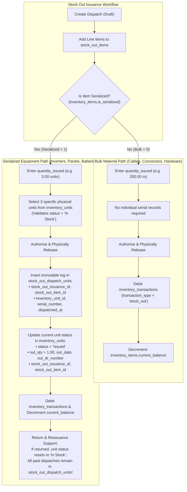

# PHASE 2 REVISED DATABASE SCHEMA AND PERMISSION REPORT

**System:** Pagecom Inc. / SYB Business Management System (BMS)  
**Database:** MySQL / MariaDB (`business_management_system`, 10.4.32-MariaDB InnoDB)  
**Document Status:** Revised Schema Preparation & Architecture Blueprint (Phase 2 Revision Deliverable)  
**Migration File:** [`database/migrations/010_stock_out_and_ending_balance_phase2.sql`](file:///c:/xampp/htdocs/BMS/database/migrations/010_stock_out_and_ending_balance_phase2.sql)  
**Changelog Reference:** [`docs/PHASE_2_REVISION_CHANGELOG.md`](file:///c:/xampp/htdocs/BMS/docs/PHASE_2_REVISION_CHANGELOG.md)  
**Date:** November 2026  
**Execution Status:** **PREPARED ONLY — NOT YET EXECUTED (Awaiting Review & Approval)**  

---

## 1. Existing Database Structures Inspected

A direct technical inspection was executed on the live MariaDB 10.4.32 instance for all 15 operational tables. The inspection confirmed column definitions, primary/unique keys, indexes, foreign key constraints, and existing role-permission assignments:

### 1.1 `inventory_items` (Stock Catalog & Perpetual Running Balance)
* **Columns (12):** `id` (int unsigned, PK), `item_code` (varchar(50), UNIQUE), `item_name` (varchar(200)), `model_part_number` (varchar(100), nullable), `category` (varchar(60), default 'Serialized Equipment'), `unit_of_measure` (varchar(50), default 'pcs'), `is_serialized` (tinyint(1), default 1), `current_balance` (decimal(12,2), default 0.00), `description` (text, nullable), `status` (varchar(20), default 'active'), `created_at`, `updated_at`.
* **Indexes (3):** `PRIMARY` on `id`, `uq_inv_item_code` on `item_code`, `idx_inv_item_category` on `category`.
* **Foreign Keys:** None.
* **Finding:** Fully functional. Tracks the aggregate running stock balance. Can be updated directly when stock out is performed.

### 1.2 `inventory_transactions` (Double-Entry Perpetual Stock Movement Ledger)
* **Columns (17):** `id` (bigint unsigned, PK), `transaction_number` (varchar(60), UNIQUE), `transaction_type` (varchar(40)), `inventory_item_id` (int unsigned, FK), `quantity` (decimal(12,2)), `unit_of_measure` (varchar(50)), `warehouse_location` (varchar(100)), `project_id` (int unsigned, nullable, FK), `jom_number` (varchar(50), nullable), `reference_type` (varchar(60)), `reference_id` (int unsigned), `balance_before` (decimal(12,2)), `balance_after` (decimal(12,2)), `performed_by` (int unsigned, FK), `remarks` (varchar(500), nullable), `transaction_date` (datetime), `created_at`.
* **Indexes (5):** `PRIMARY` on `id`, `uq_inv_txn_number` on `transaction_number`, `idx_it_item` on `(inventory_item_id, created_at)`, `idx_it_project` on `project_id`, `idx_it_ref` on `(reference_type, reference_id)`, `fk_it_user` on `performed_by`.
* **Foreign Keys (3):**
  * `fk_it_item`: `inventory_item_id` $\to$ `inventory_items(id)`
  * `fk_it_project`: `project_id` $\to$ `projects(id)` ON DELETE SET NULL
  * `fk_it_user`: `performed_by` $\to$ `users(id)`
* **Finding:** Already designed as a generic double-entry ledger. Supports `transaction_type = 'stock_out'`, recording `reference_type = 'stock_out'` and `reference_id = stock_out_issuances.id`. No column changes needed; benefits from an index on `(transaction_type, transaction_date)` for fast ending balance reporting.

### 1.3 `inventory_units` (Physical Serialized Equipment Units)
* **Columns (21):** `id` (int unsigned, PK), `item_number` (int unsigned, default 1), `po_number` (varchar(60)), `po_date` (date), `model` (varchar(100)), `description` (varchar(255)), `warranty_duration` (varchar(100), default '1 Year'), `serial_number` (varchar(150), UNIQUE), `in_qty` (decimal(12,2), default 1.00), `inventory_date` (date), `inventory_item_id` (int unsigned, FK), `purchase_order_id` (int unsigned, FK), `delivery_id` (int unsigned, FK), `stock_in_transaction_id` (bigint unsigned, FK), `project_id` (int unsigned, nullable, FK), `jom_number` (varchar(50), nullable), `status` (varchar(50), default 'In Stock'), `current_location` (varchar(150), default 'PCT Warehouse'), `created_by` (int unsigned, FK), `created_at`, `updated_at`.
* **Indexes (9):** `PRIMARY` on `id`, `uq_iu_serial` on `serial_number`, `idx_iu_item` on `inventory_item_id`, `idx_iu_po` on `purchase_order_id`, `idx_iu_delivery` on `delivery_id`, `idx_iu_status` on `status`, `idx_iu_project` on `project_id`, `fk_iu_txn` on `stock_in_transaction_id`, `fk_iu_creator` on `created_by`.
* **Foreign Keys (6):** `fk_iu_creator` $\to$ `users(id)`, `fk_iu_delivery` $\to$ `supplier_deliveries(id)`, `fk_iu_item` $\to$ `inventory_items(id)`, `fk_iu_po` $\to$ `purchase_orders(id)`, `fk_iu_project` $\to$ `projects(id)`, `fk_iu_txn` $\to$ `inventory_transactions(id)`.
* **Finding:** Contains full intake/receiving details, but **completely lacks Stock Out dispatch fields**. `status` column currently defaults to `'In Stock'` and is indexed, making it ready to transition to `'Issued'`.

### 1.4 Upstream Modules (`purchase_orders`, `purchase_requests`, `supplier_deliveries`, `project_documents`)
* `purchase_orders` & `purchase_order_items`: Full PO tracking with authorized approvals, pricing, and quantities received.
* `purchase_requests` & `purchase_request_items`: Full PR state machine with approved vs. ordered quantity constraints.
* `supplier_deliveries` & `supplier_delivery_items`: Inspection tracking with delivered vs. accepted vs. rejected splits.
* `project_documents`: Reusable for attaching signed outgoing DR scans or invoice copies.

### 1.5 Department & Permission Infrastructure (`users`, `departments`, `roles`, `permissions`, `role_permissions`)
* `departments`: 6 active departments (`MKT`, `PM`, `OPS`, `LOG`, `OPFIN`, `ADMFIN`).
* `roles`: 2 active roles (`administrator`, `department_user`).
* `permissions`: 48 existing permissions across 9 module groups.

---

## 2. Confirmed Missing Structures & Architectural Corrections

The following gaps were confirmed and refined during this revision:

1. **Missing Dispatch Header Table (`stock_out_issuances`):**
   * Needs to track commercial dispatch references (`out_dr_number`, `invoice_number`), recipient entity (`recipient_company`, `recipient_address`), logistics (`carrier_name`, `vehicle_plate_no`), and project context.
   * **CORRECTION IMPLEMENTED:** The initial draft improperly defaulted status to `'Dispatched'`. The revised lifecycle strictly defaults to `'Draft'`, transitioning through:
     $$\text{Draft} \longrightarrow \text{Submitted for Authorization} \longrightarrow \text{Authorized} \longrightarrow \text{Dispatched} \quad (\text{or } \text{Cancelled})$$
   * **CORRECTION IMPLEMENTED:** Separated audit responsibilities by removing the singular `issued_by` field and implementing dedicated personnel columns: `prepared_by` / `prepared_at`, `authorized_by` / `authorized_at`, `dispatched_by` / `dispatched_at`, and `cancelled_by` / `cancelled_at`.
2. **Missing Detail Table (`stock_out_items`):**
   * Necessary to support multiple inventory items and bulk/serialized mixes under a single Dispatch DR.
   * **CORRECTION IMPLEMENTED:** Changed deletion rule from `ON DELETE CASCADE` to `ON DELETE RESTRICT` to ensure completed or active line items can never be deleted from under an issuance.
3. **Missing Columns on `inventory_units`:**
   * Lacks linkage to outgoing dispatch, outgoing DR number, commercial invoice number, out date, out quantity, recipient company/address, and warranty expiration date.
   * **CORRECTION IMPLEMENTED:** Enforced `ON DELETE RESTRICT` on all unit foreign keys (`stock_out_issuance_id`, `stock_out_item_id`, `stock_out_transaction_id`) to strictly prevent deleting any issuance or ledger entry that has issued physical units.
4. **Missing Permissions:**
   * Missing granular permissions: `log.stock_out.view`, `log.stock_out.create`, `log.stock_out.authorize`, `log.stock_out.manage`, `log.stock_out.dispatch`, `inv.reports.view`, `inv.adjustments.manage`.

---

## 3. Revised Schema Changes

All schema changes are located in [`database/migrations/010_stock_out_and_ending_balance_phase2.sql`](file:///c:/xampp/htdocs/BMS/database/migrations/010_stock_out_and_ending_balance_phase2.sql).

### 3.1 Table: `stock_out_issuances` (Revised)
```sql
CREATE TABLE IF NOT EXISTS `stock_out_issuances` (
    `id` INT UNSIGNED NOT NULL AUTO_INCREMENT,
    `dispatch_number` VARCHAR(60) NOT NULL,
    `out_dr_number` VARCHAR(100) NULL,
    `invoice_number` VARCHAR(100) NULL,
    `out_date` DATE NULL,
    `project_id` INT UNSIGNED NULL,
    `jom_number` VARCHAR(50) NULL,
    `recipient_company` VARCHAR(200) NOT NULL,
    `recipient_address` TEXT NOT NULL,
    `recipient_contact` VARCHAR(150) NULL,
    `purpose_of_issuance` VARCHAR(255) NOT NULL DEFAULT 'Project Jobsite Installation',
    `carrier_name` VARCHAR(150) NULL,
    `vehicle_plate_no` VARCHAR(50) NULL,
    `supporting_document_id` INT UNSIGNED NULL,
    `status` VARCHAR(50) NOT NULL DEFAULT 'Draft',
    `prepared_by` INT UNSIGNED NOT NULL,
    `prepared_at` DATETIME NOT NULL DEFAULT CURRENT_TIMESTAMP,
    `authorized_by` INT UNSIGNED NULL,
    `authorized_at` DATETIME NULL,
    `dispatched_by` INT UNSIGNED NULL,
    `dispatched_at` DATETIME NULL,
    `cancelled_by` INT UNSIGNED NULL,
    `cancelled_at` DATETIME NULL,
    `cancellation_reason` TEXT NULL,
    `notes` TEXT NULL,
    `created_at` DATETIME NOT NULL DEFAULT CURRENT_TIMESTAMP,
    `updated_at` DATETIME NOT NULL DEFAULT CURRENT_TIMESTAMP ON UPDATE CURRENT_TIMESTAMP,
    PRIMARY KEY (`id`),
    UNIQUE KEY `uq_so_dispatch_no` (`dispatch_number`),
    KEY `idx_so_dr_no` (`out_dr_number`),
    KEY `idx_so_invoice_no` (`invoice_number`),
    KEY `idx_so_project` (`project_id`),
    KEY `idx_so_out_date` (`out_date`),
    KEY `idx_so_status` (`status`),
    KEY `idx_so_prepared_by` (`prepared_by`),
    KEY `idx_so_authorized_by` (`authorized_by`),
    KEY `idx_so_dispatched_by` (`dispatched_by`),
    CONSTRAINT `fk_so_project` FOREIGN KEY (`project_id`) REFERENCES `projects` (`id`) ON DELETE SET NULL,
    CONSTRAINT `fk_so_prepared_by` FOREIGN KEY (`prepared_by`) REFERENCES `users` (`id`) ON DELETE RESTRICT,
    CONSTRAINT `fk_so_authorized_by` FOREIGN KEY (`authorized_by`) REFERENCES `users` (`id`) ON DELETE SET NULL,
    CONSTRAINT `fk_so_dispatched_by` FOREIGN KEY (`dispatched_by`) REFERENCES `users` (`id`) ON DELETE SET NULL,
    CONSTRAINT `fk_so_cancelled_by` FOREIGN KEY (`cancelled_by`) REFERENCES `users` (`id`) ON DELETE SET NULL,
    CONSTRAINT `fk_so_doc` FOREIGN KEY (`supporting_document_id`) REFERENCES `project_documents` (`id`) ON DELETE SET NULL
) ENGINE=InnoDB DEFAULT CHARSET=utf8mb4 COLLATE=utf8mb4_unicode_ci;
```

### 3.2 Table: `stock_out_items` (Revised with ON DELETE RESTRICT)
```sql
CREATE TABLE IF NOT EXISTS `stock_out_items` (
    `id` INT UNSIGNED NOT NULL AUTO_INCREMENT,
    `stock_out_issuance_id` INT UNSIGNED NOT NULL,
    `inventory_item_id` INT UNSIGNED NOT NULL,
    `line_no` INT UNSIGNED NOT NULL DEFAULT 1,
    `item_description` VARCHAR(255) NOT NULL,
    `model_part_number` VARCHAR(100) NULL,
    `quantity_issued` DECIMAL(12,2) NOT NULL DEFAULT 1.00,
    `unit_of_measure` VARCHAR(50) NOT NULL DEFAULT 'pcs',
    `unit_price` DECIMAL(15,2) NOT NULL DEFAULT 0.00,
    `total_amount` DECIMAL(15,2) NOT NULL DEFAULT 0.00,
    `remarks` VARCHAR(500) NULL,
    `created_at` DATETIME NOT NULL DEFAULT CURRENT_TIMESTAMP,
    `updated_at` DATETIME NOT NULL DEFAULT CURRENT_TIMESTAMP ON UPDATE CURRENT_TIMESTAMP,
    PRIMARY KEY (`id`),
    UNIQUE KEY `uq_soi_line` (`stock_out_issuance_id`, `line_no`),
    KEY `idx_soi_item` (`inventory_item_id`),
    CONSTRAINT `fk_soi_issuance` FOREIGN KEY (`stock_out_issuance_id`) REFERENCES `stock_out_issuances` (`id`) ON DELETE RESTRICT,
    CONSTRAINT `fk_soi_item` FOREIGN KEY (`inventory_item_id`) REFERENCES `inventory_items` (`id`) ON DELETE RESTRICT,
    CONSTRAINT `chk_soi_quantity` CHECK (`quantity_issued` > 0.00),
    CONSTRAINT `chk_soi_unit_price` CHECK (`unit_price` >= 0.00),
    CONSTRAINT `chk_soi_total_amount` CHECK (`total_amount` >= 0.00)
) ENGINE=InnoDB DEFAULT CHARSET=utf8mb4 COLLATE=utf8mb4_unicode_ci;
```

### 3.3 Table: `stock_out_dispatch_units` (Immutable Serialized Dispatch & Return Log)
```sql
CREATE TABLE IF NOT EXISTS `stock_out_dispatch_units` (
    `id` BIGINT UNSIGNED NOT NULL AUTO_INCREMENT,
    `stock_out_issuance_id` INT UNSIGNED NOT NULL,
    `stock_out_item_id` INT UNSIGNED NOT NULL,
    `inventory_unit_id` INT UNSIGNED NOT NULL,
    `serial_number` VARCHAR(150) NOT NULL,
    `dispatched_at` DATETIME NOT NULL,
    `status` VARCHAR(50) NOT NULL DEFAULT 'Dispatched',
    `returned_at` DATETIME NULL,
    `return_reference_no` VARCHAR(100) NULL,
    `return_transaction_id` BIGINT UNSIGNED NULL,
    `created_at` DATETIME NOT NULL DEFAULT CURRENT_TIMESTAMP,
    `updated_at` DATETIME NOT NULL DEFAULT CURRENT_TIMESTAMP ON UPDATE CURRENT_TIMESTAMP,
    PRIMARY KEY (`id`),
    KEY `idx_sodu_issuance` (`stock_out_issuance_id`),
    KEY `idx_sodu_item` (`stock_out_item_id`),
    KEY `idx_sodu_unit` (`inventory_unit_id`),
    KEY `idx_sodu_serial` (`serial_number`),
    KEY `idx_sodu_status` (`status`),
    CONSTRAINT `fk_sodu_issuance` FOREIGN KEY (`stock_out_issuance_id`) REFERENCES `stock_out_issuances` (`id`) ON DELETE RESTRICT,
    CONSTRAINT `fk_sodu_item` FOREIGN KEY (`stock_out_item_id`) REFERENCES `stock_out_items` (`id`) ON DELETE RESTRICT,
    CONSTRAINT `fk_sodu_unit` FOREIGN KEY (`inventory_unit_id`) REFERENCES `inventory_units` (`id`) ON DELETE RESTRICT,
    CONSTRAINT `fk_sodu_return_txn` FOREIGN KEY (`return_transaction_id`) REFERENCES `inventory_transactions` (`id`) ON DELETE RESTRICT
) ENGINE=InnoDB DEFAULT CHARSET=utf8mb4 COLLATE=utf8mb4_unicode_ci;
```

### 3.4 Alter Table: `inventory_units` (Revised with ON DELETE RESTRICT)
```sql
ALTER TABLE `inventory_units`
    ADD COLUMN IF NOT EXISTS `stock_out_issuance_id` INT UNSIGNED NULL AFTER `stock_in_transaction_id`,
    ADD COLUMN IF NOT EXISTS `stock_out_item_id` INT UNSIGNED NULL AFTER `stock_out_issuance_id`,
    ADD COLUMN IF NOT EXISTS `stock_out_transaction_id` BIGINT UNSIGNED NULL AFTER `stock_out_item_id`,
    ADD COLUMN IF NOT EXISTS `out_date` DATE NULL AFTER `inventory_date`,
    ADD COLUMN IF NOT EXISTS `out_qty` DECIMAL(12,2) NOT NULL DEFAULT 0.00 AFTER `in_qty`,
    ADD COLUMN IF NOT EXISTS `warranty_expiration_date` DATE NULL AFTER `warranty_duration`,
    ADD COLUMN IF NOT EXISTS `issued_to_company` VARCHAR(200) NULL AFTER `current_location`,
    ADD COLUMN IF NOT EXISTS `issued_to_address` TEXT NULL AFTER `issued_to_company`,
    ADD COLUMN IF NOT EXISTS `out_dr_number` VARCHAR(100) NULL AFTER `issued_to_address`,
    ADD COLUMN IF NOT EXISTS `invoice_number` VARCHAR(100) NULL AFTER `out_dr_number`,
    ADD INDEX IF NOT EXISTS `idx_iu_so_issuance` (`stock_out_issuance_id`),
    ADD INDEX IF NOT EXISTS `idx_iu_so_item` (`stock_out_item_id`),
    ADD INDEX IF NOT EXISTS `idx_iu_so_txn` (`stock_out_transaction_id`),
    ADD INDEX IF NOT EXISTS `idx_iu_out_date` (`out_date`),
    ADD INDEX IF NOT EXISTS `idx_iu_out_dr_no` (`out_dr_number`),
    ADD INDEX IF NOT EXISTS `idx_iu_invoice_no` (`invoice_number`);
```

Foreign keys added with dynamic check:
* `fk_iu_so_issuance`: `stock_out_issuance_id` $\to$ `stock_out_issuances(id)` **`ON DELETE RESTRICT`**
* `fk_iu_so_item`: `stock_out_item_id` $\to$ `stock_out_items(id)` **`ON DELETE RESTRICT`**
* `fk_iu_so_txn`: `stock_out_transaction_id` $\to$ `inventory_transactions(id)` **`ON DELETE RESTRICT`**

---

## 4. Serialized vs. Bulk Inventory Tracking Mechanics

The schema unified under `stock_out_issuances` and `stock_out_items` supports both modes seamlessly:



---

## 5. Permissions, Department Separation & Server-Side Enforcement

### 5.1 Granular Permissions Seeding
The revised migration seeds 7 permissions under module group `Receiving & Inventory`:

1. `log.stock_out.view`: View equipment stock out issuances, dispatch receipts, and deployed unit logs.
2. `log.stock_out.create`: Prepare draft stock out dispatches and record requested equipment lines.
3. `log.stock_out.authorize`: Formally authorize submitted equipment dispatches prior to physical release.
4. `log.stock_out.manage`: Administrative control to manage, authorize, or cancel stock out dispatches.
5. `log.stock_out.dispatch`: Confirm physical release, assign serial numbers, and post stock out inventory movements.
6. `inv.reports.view`: Access ending balance calculations, perpetual stock ledger, and discrepancy reports.
7. `inv.adjustments.manage`: Perform authorized manual stock balance adjustments with documented audit reasons.

### 5.2 SQL Role Assignment Boundary vs. PHP Application Guard
* **Database Role Boundary:** In this application schema, the `roles` table contains only two roles: `administrator` and `department_user`. All non-admin employees across Marketing, PM, Operations, Logistics, Operation Finance, and Admin Finance share `role_slug = 'department_user'`.
* **SQL Role Safety Rule:** The SQL migration grants `administrator` all permissions, but grants `department_user` **only baseline non-authorizing permissions** (`log.stock_out.view`, `log.stock_out.create`, `inv.reports.view`). High-privilege permissions (`.authorize`, `.dispatch`, `.manage`, `inv.adjustments.manage`) are **NOT** granted to `department_user` in SQL.
* **PHP Server-Side Segregation:** SQL role assignments alone **cannot** enforce department-level boundaries because SQL has no concept of a user's department. True departmental authorization is enforced exclusively in PHP [`App\Services\AuthorizationService`](file:///c:/xampp/htdocs/BMS/app/Services/AuthorizationService.php) by checking `user.department_code`.

### 5.3 Department Authorization Matrix (Server-Side Enforced)

In BMS, server-side permissions are enforced through [`App\Services\AuthorizationService`](file:///c:/xampp/htdocs/BMS/app/Services/AuthorizationService.php) checking authenticated user department codes and role slugs:

| Role / Department | View Dispatches (`.view`) | Create Draft (`.create`) | Authorize Dispatch (`.authorize`) | Physical Release (`.dispatch`) | View Reports (`.reports.view`) | Stock Adjustments (`.adjustments`) | Authority Summary |
| :--- | :---: | :---: | :---: | :---: | :---: | :---: | :--- |
| **Administrator** | Yes | Yes | Yes | Yes | Yes | Yes | Full administrative oversight. |
| **Logistics (`LOG`)** | Yes | Yes | Yes | Yes | Yes | Yes | **Primary Physical Custody:** Prepares drafts, authorizes dispatch, records serials, executes physical release, manages inventory adjustments. |
| **Operations (`OPS`)** | Yes | Yes | **No** | **No** | Yes | **No** | **Field Requisition:** Can prepare draft dispatches for project sites and view stock availability. **Cannot authorize or release stock.** |
| **Admin Finance (`ADMFIN`)** | Yes | **No** | Yes | **No** | Yes | Yes | **Commercial & Financial Control:** Retains 100% of PO authority (`afin.po.*`). Can authorize dispatches tied to commercial invoices, view valuation reports, and audit adjustments. **Cannot physically release equipment.** |
| **Operation Finance (`OPFIN`)** | Yes | **No** | **No** | **No** | Yes | **No** | **Cost & Actual BOM Monitoring:** Can view stock movements and ending balance reports to audit consumption against Actual BOM. **Cannot author, authorize, or dispatch stock.** |
| **Marketing (`MKT`)** | **No** | **No** | **No** | **No** | **No** | **No** | Strictly blocked. |
| **Project Management (`PM`)** | **No** | **No** | **No** | **No** | **No** | **No** | Strictly blocked. |

---

## 6. Migration SQL & Cross-Compatibility Analysis

* **Engine:** MariaDB 10.4.32 / MySQL 8.0+ InnoDB.
* **Charset / Collation:** `utf8mb4` / `utf8mb4_unicode_ci`.
* **Idempotency:**
  * Tables created with `CREATE TABLE IF NOT EXISTS`.
  * Columns added via `ADD COLUMN IF NOT EXISTS`.
  * Indexes added via `ADD INDEX IF NOT EXISTS`.
  * Foreign key constraints are added conditionally using dynamic SQL queries checking `information_schema.TABLE_CONSTRAINTS WHERE CONSTRAINT_SCHEMA = DATABASE()`. This prevents duplicate constraint errors if the migration script is run repeatedly.
* **Exact Foreign Key Data Types:**
  * `stock_out_issuances.id` (`INT UNSIGNED`) $\longleftrightarrow$ `stock_out_items.stock_out_issuance_id` (`INT UNSIGNED`)
  * `stock_out_issuances.id` (`INT UNSIGNED`) $\longleftrightarrow$ `inventory_units.stock_out_issuance_id` (`INT UNSIGNED`)
  * `stock_out_items.id` (`INT UNSIGNED`) $\longleftrightarrow$ `inventory_units.stock_out_item_id` (`INT UNSIGNED`)
  * `inventory_transactions.id` (`BIGINT UNSIGNED`) $\longleftrightarrow$ `inventory_units.stock_out_transaction_id` (`BIGINT UNSIGNED`)
  * All column types, signedness, and character sets match their referenced keys 100%.

---

## 7. Migration Safety & Controlled Rollback Limitations

### 7.1 Safety Guarantees
* **Zero Destruction:** No `DROP TABLE`, `TRUNCATE`, or `ALTER TABLE ... DROP` statements exist in the migration.
* **Existing Intake Protected:** Existing records in `inventory_units` retain their existing values (`status = 'In Stock'`, `out_qty = 0.00`, and nullable stock-out fields).
* **Ledger Untouched:** `inventory_transactions` rows are preserved; only a performance index `idx_it_type_date` is added.

### 7.2 Strict Rollback Policy
> [!CAUTION]
> **Controlled Rollback Warning:** Dropping `stock_out_issuances`, `stock_out_items`, or foreign keys from `inventory_units` will permanently destroy dispatch history and sever the audit trail of issued physical units. Rollback must **never** be executed silently in a production environment where live transactions have been recorded.
>
> If a rollback is required during testing prior to live data entry, the following verified procedure must be followed:

```sql
USE `business_management_system`;

-- 1. Remove foreign key constraints from inventory_units
SET @fk_iu_so_issuance_exists = (SELECT COUNT(*) FROM information_schema.TABLE_CONSTRAINTS WHERE CONSTRAINT_SCHEMA = DATABASE() AND TABLE_NAME = 'inventory_units' AND CONSTRAINT_NAME = 'fk_iu_so_issuance');
SET @sql_drop_fk1 = IF(@fk_iu_so_issuance_exists > 0, 'ALTER TABLE `inventory_units` DROP FOREIGN KEY `fk_iu_so_issuance`', 'SELECT 1');
PREPARE stmt_drop_fk1 FROM @sql_drop_fk1; EXECUTE stmt_drop_fk1; DEALLOCATE PREPARE stmt_drop_fk1;

SET @fk_iu_so_item_exists = (SELECT COUNT(*) FROM information_schema.TABLE_CONSTRAINTS WHERE CONSTRAINT_SCHEMA = DATABASE() AND TABLE_NAME = 'inventory_units' AND CONSTRAINT_NAME = 'fk_iu_so_item');
SET @sql_drop_fk2 = IF(@fk_iu_so_item_exists > 0, 'ALTER TABLE `inventory_units` DROP FOREIGN KEY `fk_iu_so_item`', 'SELECT 1');
PREPARE stmt_drop_fk2 FROM @sql_drop_fk2; EXECUTE stmt_drop_fk2; DEALLOCATE PREPARE stmt_drop_fk2;

SET @fk_iu_so_txn_exists = (SELECT COUNT(*) FROM information_schema.TABLE_CONSTRAINTS WHERE CONSTRAINT_SCHEMA = DATABASE() AND TABLE_NAME = 'inventory_units' AND CONSTRAINT_NAME = 'fk_iu_so_txn');
SET @sql_drop_fk3 = IF(@fk_iu_so_txn_exists > 0, 'ALTER TABLE `inventory_units` DROP FOREIGN KEY `fk_iu_so_txn`', 'SELECT 1');
PREPARE stmt_drop_fk3 FROM @sql_drop_fk3; EXECUTE stmt_drop_fk3; DEALLOCATE PREPARE stmt_drop_fk3;

-- 2. Drop added columns and indexes from inventory_units
ALTER TABLE `inventory_units`
    DROP COLUMN IF EXISTS `invoice_number`,
    DROP COLUMN IF EXISTS `out_dr_number`,
    DROP COLUMN IF EXISTS `issued_to_address`,
    DROP COLUMN IF EXISTS `issued_to_company`,
    DROP COLUMN IF EXISTS `warranty_expiration_date`,
    DROP COLUMN IF EXISTS `out_qty`,
    DROP COLUMN IF EXISTS `out_date`,
    DROP COLUMN IF EXISTS `stock_out_transaction_id`,
    DROP COLUMN IF EXISTS `stock_out_item_id`,
    DROP COLUMN IF EXISTS `stock_out_issuance_id`;

-- 3. Drop index from inventory_transactions
ALTER TABLE `inventory_transactions`
    DROP INDEX IF EXISTS `idx_it_type_date`;

-- 4. Drop new tables (only safe if no production records exist)
DROP TABLE IF EXISTS `stock_out_items`;
DROP TABLE IF EXISTS `stock_out_issuances`;

-- 5. Remove seeded permissions
DELETE FROM `role_permissions` WHERE `permission_id` IN (
    SELECT `id` FROM `permissions` WHERE `permission_key` IN (
        'log.stock_out.view',
        'log.stock_out.create',
        'log.stock_out.authorize',
        'log.stock_out.manage',
        'log.stock_out.dispatch',
        'inv.reports.view',
        'inv.adjustments.manage'
    )
);
DELETE FROM `permissions` WHERE `permission_key` IN (
    'log.stock_out.view',
    'log.stock_out.create',
    'log.stock_out.authorize',
    'log.stock_out.manage',
    'log.stock_out.dispatch',
    'inv.reports.view',
    'inv.adjustments.manage'
);
```

---

## 8. Exact SQL Execution Instructions (Awaiting Approval)

When approved, the migration can be executed via MySQL CLI or PHP migration runner:

```powershell
# Method 1: Using MySQL CLI (via XAMPP)
c:\xampp\mysql\bin\mysql.exe -u root -p business_management_system < c:\xampp\htdocs\BMS\database\migrations\010_stock_out_and_ending_balance_phase2.sql

# Method 2: Via PHP PDO Runner
php -r "
require 'c:/xampp/htdocs/BMS/app/Core/Env.php';
App\Core\Env::load('c:/xampp/htdocs/BMS/.env');
\$pdo = new PDO('mysql:host=127.0.0.1;dbname=business_management_system;charset=utf8mb4', 'root', '');
\$sql = file_get_contents('c:/xampp/htdocs/BMS/database/migrations/010_stock_out_and_ending_balance_phase2.sql');
\$pdo->exec(\$sql);
echo 'Migration 010 applied successfully.' . PHP_EOL;
"
```

---

## 9. Phase 2 Status: Strictly Paused Awaiting Approval

In accordance with the **STRICT STOP CONDITION**:
* The migration has **NOT** been run.
* No production data or schema was altered.
* No UI or business logic was written.
* Execution is paused awaiting your explicit review and authorization.
