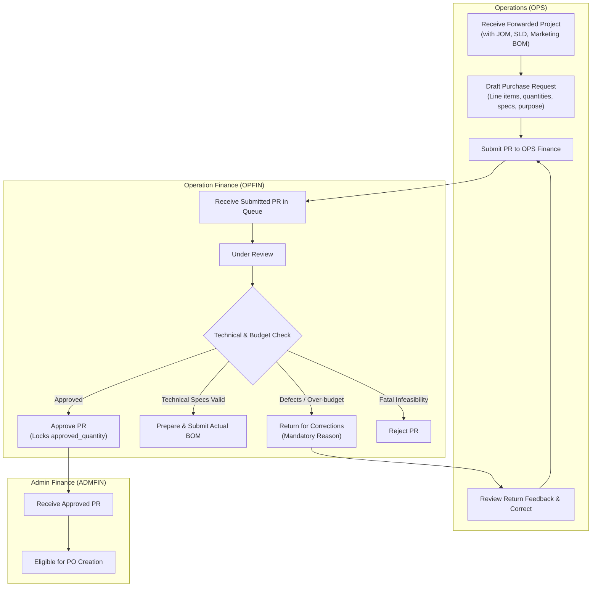
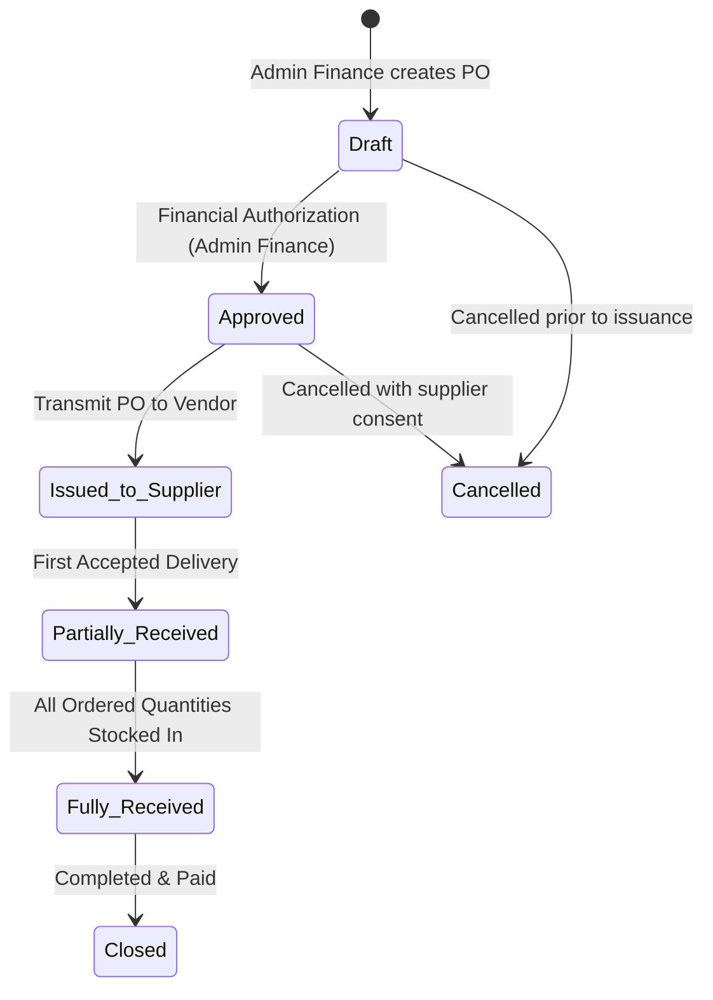
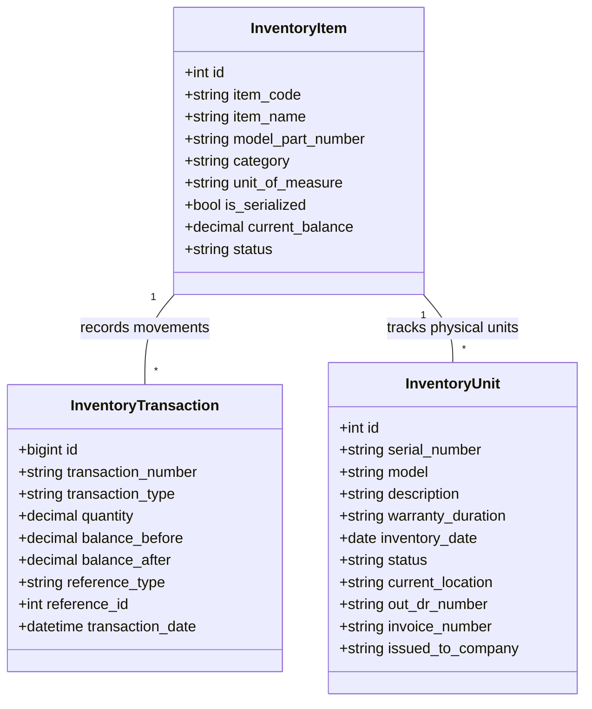
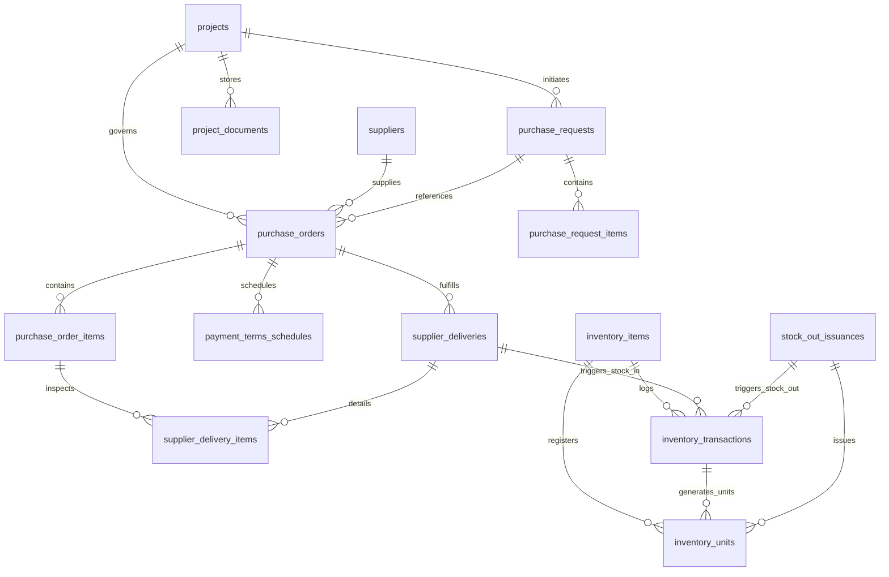
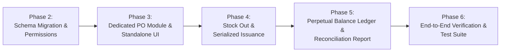

# PURCHASE REQUEST TO PURCHASE ORDER TO INVENTORY INTEGRATION PLAN

**Document Status:** Architecture & Implementation Blueprint (Phase 1 Deliverable)  
**System:** Pagecom Inc. / SYB Business Management System (BMS)  
**Technology Stack:** Native PHP 8.2+, MySQL / MariaDB (InnoDB, utf8mb4), PDO, Bootstrap 5, Custom Lightweight MVC  
**Base Directory:** `c:\xampp\htdocs\BMS`  
**Date:** November 2026  

---

## Executive Summary

The Business Management System (BMS) implements an enterprise multi-department governance pipeline across six departments: **Marketing (MKT)**, **Project Management (PM)**, **Admin Finance (ADMFIN)**, **Operations (OPS)**, **Operation Finance (OPFIN)**, and **Logistics (LOG)**.

The objective of this architectural audit and integration plan is to formalize and extend the end-to-end procurement and inventory lifecycle:

$$\begin{aligned}
\text{Purchase Request (PR)} &\longrightarrow \text{Purchase Order (PO)} \longrightarrow \text{Terms of Payment} \longrightarrow \text{Supplier Delivery (DR)} \\
&\longrightarrow \text{Stock In} \longrightarrow \text{Inventory Management} \longrightarrow \text{Stock Out} \longrightarrow \text{Ending Balance}
\end{aligned}$$

This document provides a thorough audit of the existing codebase and database, maps out the structural changes required to complete Steps 1 through 8, specifies database relationship enhancements, details security controls, and outlines a phased execution sequence.

---

## 1. Existing PR Module Architecture

The Purchase Request (PR) module is fully functional and tightly integrated with the project governance lifecycle.

### 1.1 Process & Department Ownership
* **Authoring Department:** **Operations (`OPS`)** is the sole creator and editor of Purchase Requests. Operations prepares PRs once a project has been officially forwarded with an issued Job Order Memorandum (JOM) number.
* **Review & Approval Department:** **Operation Finance (`OPFIN`)** reviews submitted PRs. OPS Finance possesses the authority to return a PR for corrections (with documented reasons), approve line items, or reject the request. Admin Finance (`ADMFIN`) and Administrators also hold approval privileges.
* **Separation of Concerns:** 
  * Operations handles technical field requirements, model specifications, quantities, and operational justification.
  * Operation Finance verifies project budgets and prepares the separate **Actual BOM with Specifications**.
  * Admin Finance handles financial authorization and procurement execution.

### 1.2 PR Creation & Number Generation
* **Controller:** [`App\Controllers\OperationsController::savePurchaseRequest`](file:///c:/xampp/htdocs/BMS/app/Controllers/OperationsController.php) validates inputs and coordinates persistence.
* **Service:** [`App\Services\PurchaseRequestService::generateUniquePrNumber`](file:///c:/xampp/htdocs/BMS/app/Services/PurchaseRequestService.php) formats PR numbers as:
  $$\text{PR-YYYYMM-XXXX}$$
  * Format: `PR-` followed by the 4-digit year, 2-digit month, and a sequential 4-digit zero-padded integer (e.g., `PR-202611-0001`).
  * Collision handling: Queries `purchase_requests` table using prefix matching and extracts the highest sequence to ensure gapless, collision-free numbering under high concurrency.
* **Lifecycle State Machine:**
  * `Draft`: Created by Operations; fully editable.
  * `Submitted to OPS Finance`: Locked for Operations; routed to OPS Finance queue.
  * `Under OPS Finance Review`: Acknowledged by OPS Finance reviewer.
  * `Returned for Corrections`: Returned to Operations with mandatory return reason; Operations can edit and resubmit.
  * `Approved`: Formally approved; `approved_quantity` is established on all line items; eligible for PO generation.
  * `Rejected`: Formally terminated with documented reason.
  * `Partially Ordered`: Linked to one or more POs where total ordered quantity is less than approved quantity.
  * `Converted to PO / Fully Ordered`: All approved quantities are fully covered by authorized POs.

### 1.3 PR Form Fields & Item Details
* **Header Fields (`purchase_requests`):**
  * Project Reference: `project_id`, `jom_number`.
  * Department Routing: `requesting_department_id` (OPS), `receiving_department_id` (OPFIN).
  * Personnel: `requested_by` (OPS author), `submitted_by`, `reviewed_by`, `returned_by`, `approved_by`, `rejected_by`.
  * Dates: `pr_date`, `required_delivery_date`, `submitted_at`, `reviewed_at`, `returned_at`, `approved_at`, `rejected_at`.
  * Operational Context: `purpose`, `remarks`.
  * Document References: `attachment_document_id` (supporting quotation/specs), `sld_document_id`, `marketing_bom_document_id`, `actual_bom_id`.
* **Line Item Fields (`purchase_request_items`):**
  * `line_no`: Sequential line index ($1, 2, 3, \dots$).
  * `item_description`: Primary commercial/generic item title.
  * `model_part_number`: Manufacturer part number or model code.
  * `item_specification`: In-depth technical requirements, voltage ratings, mechanical tolerances, etc.
  * `quantity`: Quantity requested by Operations.
  * `unit_of_measure`: Standard units (e.g., `pcs`, `units`, `sets`, `meters`, `rolls`, `lots`).
  * `purpose`: Specific field application or subsystem destination.
  * `approved_quantity`: Quantity authorized by OPS Finance (defaults to requested quantity upon approval).
  * `ordered_quantity`: Cumulative quantity committed to downstream Purchase Orders.
  * `remarks`: Technical caveats or vendor preferences.

### 1.4 Project, JOM, and Document Linkages
* Every PR must link to a valid `projects` row with an assigned, unique `jom_number`.
* Admin Finance issues the official JOM after PM verification. Operations cannot create a PR without an existing JOM.
* **Marketing BOM vs. Actual BOM Separation:**
  * Marketing BOM is uploaded by Marketing during initial registration (`project_documents`).
  * Operations prepares the PR based on the Marketing BOM and Single Line Diagram (SLD).
  * OPS Finance receives the PR and compiles the **Actual BOM** (`actual_boms`, `actual_bom_items`) containing manufacturer specifications and costs.
  * The PR maintains separate foreign keys to `marketing_bom_document_id` and `actual_bom_id`.

---

## 2. Existing Database Structure

The database currently consists of 25 relational tables running on MySQL / MariaDB InnoDB with foreign key integrity.

### 2.1 Audit of Existing Relevant Tables

| Table Name | Primary Key | Foreign Keys & Relationships | Important Columns | Status & Reuse Plan |
| :--- | :--- | :--- | :--- | :--- |
| `departments` | `id` (INT UN) | None | `department_name`, `department_code` (`MKT`, `PM`, `OPS`, `LOG`, `OPFIN`, `ADMFIN`), `status` | **Fully Reusable** for RBAC and departmental custody. |
| `roles` | `id` (INT UN) | None | `role_name`, `role_slug` (`administrator`, `department_user`) | **Fully Reusable**. |
| `permissions` | `id` (INT UN) | None | `permission_key`, `permission_name`, `module_group` | **Fully Reusable**; expand with Stock Out permissions. |
| `role_permissions` | Composite | `role_id` $\to$ `roles.id`, `permission_id` $\to$ `permissions.id` | Role permission mappings | **Fully Reusable**. |
| `users` | `id` (INT UN) | `department_id` $\to$ `departments.id`, `role_id` $\to$ `roles.id` | `full_name`, `username`, `email`, `status` | **Fully Reusable**. |
| `projects` | `id` (INT UN) | `origin_department_id`, `current_department_id`, `created_by`, `verified_by`, `jom_issued_by` | `project_code`, `jom_number`, `project_name`, `client_name`, `client_contact`, `project_location`, `status`, `verification_status` | **Fully Reusable**; acts as central operational anchor. |
| `project_documents` | `id` (INT UN) | `project_id` $\to$ `projects.id`, `uploaded_by` $\to$ `users.id` | `document_type`, `version_number`, `file_path`, `file_size`, `mime_type`, `is_current` | **Fully Reusable** for DR attachments, PO signed copies, and delivery photos. |
| `project_workflow_histories` | `id` (BIGINT UN) | `project_id`, `from_department_id`, `to_department_id`, `acted_by` | `from_status`, `to_status`, `action`, `notes`, `created_at` | **Fully Reusable** for system-wide auditability. |
| `activity_logs` | `id` (BIGINT UN) | `user_id` $\to$ `users.id` | `action`, `entity_type`, `entity_id`, `ip_address`, `user_agent`, `details`, `created_at` | **Fully Reusable** for security compliance. |
| `purchase_requests` | `id` (INT UN) | `project_id`, `requesting_department_id`, `receiving_department_id`, `requested_by`, `submitted_by`, `approved_by` | `pr_number`, `jom_number`, `status`, `ordered_quantity_total`, `ordered_status` | **Fully Reusable**; upstream anchor for all POs. |
| `purchase_request_items` | `id` (INT UN) | `purchase_request_id` $\to$ `purchase_requests.id` | `line_no`, `item_description`, `model_part_number`, `item_specification`, `quantity`, `approved_quantity`, `ordered_quantity` | **Fully Reusable**; tracks cumulative PO commitments. |
| `purchase_request_histories` | `id` (BIGINT UN) | `purchase_request_id`, `user_id` | `from_status`, `to_status`, `action`, `remarks` | **Fully Reusable**. |
| `actual_boms` | `id` (INT UN) | `project_id`, `purchase_request_id`, `document_id`, `uploaded_by` | `actual_bom_number`, `jom_number`, `version_number`, `status` | **Fully Reusable**; technical pricing baseline. |
| `actual_bom_items` | `id` (INT UN) | `actual_bom_id`, `pr_item_id` | `item_description`, `actual_specification`, `quantity` | **Fully Reusable**. |
| `suppliers` | `id` (INT UN) | `created_by` $\to$ `users.id` | `supplier_code`, `supplier_name`, `contact_person`, `email`, `phone`, `address`, `tax_identification_number`, `default_payment_terms`, `status` | **Fully Reusable**; vendor catalog. |
| `purchase_orders` | `id` (INT UN) | `purchase_request_id`, `project_id`, `supplier_id`, `created_by`, `authorized_by` | `po_number`, `po_date`, `delivery_terms`, `expected_delivery_date`, `subtotal_amount`, `tax_amount`, `total_amount`, `status` | **Fully Reusable**; procurement contract entity. |
| `purchase_order_items` | `id` (INT UN) | `purchase_order_id`, `pr_item_id` $\to$ `purchase_request_items.id` | `line_no`, `item_description`, `model_part_number`, `item_specification`, `quantity_ordered`, `unit_price`, `total_amount`, `quantity_received` | **Fully Reusable**; tracks received quantities. |
| `payment_terms_schedules` | `id` (INT UN) | `purchase_order_id`, `paid_by` | `payment_term`, `percentage`, `amount`, `due_date`, `status`, `payment_reference`, `paid_at` | **Fully Reusable**; milestone payment schedules. |
| `purchase_order_histories` | `id` (INT UN) | `purchase_order_id`, `actor_id` | `previous_status`, `new_status`, `action`, `notes` | **Fully Reusable**. |
| `supplier_deliveries` | `id` (INT UN) | `purchase_order_id`, `project_id`, `supplier_id`, `received_by`, `dr_document_id` | `delivery_receipt_no`, `delivery_date`, `carrier_name`, `tracking_or_plate_no`, `status` (`Pending Inspection`, `Inspected`, `Stocked In`) | **Fully Reusable**; DR shipment header. |
| `supplier_delivery_items` | `id` (INT UN) | `delivery_id`, `po_item_id` $\to$ `purchase_order_items.id` | `quantity_delivered`, `quantity_accepted`, `quantity_rejected`, `rejection_reason` | **Fully Reusable**; receiving inspection log. |
| `inventory_items` | `id` (INT UN) | None | `item_code`, `item_name`, `model_part_number`, `category`, `unit_of_measure`, `is_serialized`, `current_balance`, `status` | **Fully Reusable**; stock catalog & balance. |
| `inventory_transactions` | `id` (BIGINT UN) | `inventory_item_id`, `project_id`, `performed_by` | `transaction_number`, `transaction_type`, `quantity`, `warehouse_location`, `balance_before`, `balance_after`, `reference_type`, `reference_id` | **Needs Extension** for `stock_out` type and destination links. |
| `inventory_units` | `id` (INT UN) | `inventory_item_id`, `purchase_order_id`, `delivery_id`, `stock_in_transaction_id`, `project_id` | `serial_number`, `model`, `description`, `warranty_duration`, `in_qty`, `inventory_date`, `status` (`In Stock`), `current_location` | **Needs Extension** for Stock Out issuance fields and destination tracking. |

### 2.2 Identification of Missing Database Entities & Relationships
1. **Stock Out Issuance Records:** While `inventory_transactions` can record generic debit lines, the business requires tracking equipment issuances with Dispatch Delivery Receipt (DR) Number, Invoice Number, Recipient Company, Recipient Address, and Outgoing Date. A dedicated table `stock_out_issuances` (or `inventory_dispatches`) is required to bind serialized units to the issuance documentation.
2. **Serialized Unit Issuance Columns on `inventory_units`:** The current `inventory_units` table only captures intake information (`in_qty`, `inventory_date`, `po_number`). To satisfy Step 7, it must record:
   * `out_qty` (typically 1.00 for serialized units)
   * `out_date`
   * `warranty_expiration_date`
   * `issued_to_company`
   * `issued_to_address`
   * `out_dr_number`
   * `invoice_number`
   * `stock_out_transaction_id` (foreign key to `inventory_transactions`)
   * `purchase_request_id` / `pr_number` (direct traceability back to PR)
3. **Clients / Companies Entity:** Currently, client information is stored directly on the `projects` table (`client_name`, `client_contact`, `project_location`). For equipment issued to external third parties, subcontractors, or client branches, storing client records or supporting free-text company overrides on Stock Out transactions ensures full operational flexibility.

---

## 3. Existing PR Workflow



### Key Workflow Rules:
1. **JOM Precondition:** Operations cannot initiate a PR until Admin Finance has formally issued the `jom_number` and forwarded the project.
2. **Approval Gate:** An unapproved PR (`Draft`, `Submitted`, `Returned`) cannot be converted into a Purchase Order.
3. **Quantity Integrity:** The `approved_quantity` set during approval defines the upper limit for all cumulative downstream purchasing.

---

## 4. Existing Route and Controller Structure

### 4.1 Routing Map ([`routes/web.php`](file:///c:/xampp/htdocs/BMS/routes/web.php))

```
HTTP Method | Route URI                                            | Target Action Controller
-----------------------------------------------------------------------------------------------------------------------------------------
GET         | /operations/dashboard                                | OperationsController::dashboard
GET         | /operations/projects                                 | OperationsController::projects
POST        | /projects/{id}/purchase-request                      | OperationsController::savePurchaseRequest
POST        | /projects/{id}/purchase-request/submit               | OperationsController::submitPurchaseRequest
POST        | /projects/{id}/purchase-request/review               | OpsFinanceController::reviewPurchaseRequest
POST        | /projects/{id}/purchase-request/return               | OpsFinanceController::returnPurchaseRequest
POST        | /projects/{id}/purchase-request/approve              | OpsFinanceController::approvePurchaseRequest
POST        | /projects/{id}/purchase-request/reject               | OpsFinanceController::rejectPurchaseRequest
POST        | /projects/{id}/actual-bom                            | OpsFinanceController::saveActualBom
POST        | /projects/{id}/actual-bom/submit                     | OpsFinanceController::submitActualBom
POST        | /projects/{id}/actual-bom/review                     | AdminFinanceController::reviewActualBom
POST        | /projects/{id}/purchase-orders                       | AdminFinanceController::createPurchaseOrder
POST        | /projects/{id}/purchase-orders/{poId}/authorize      | AdminFinanceController::authorizePurchaseOrder
POST        | /projects/{id}/purchase-orders/{poId}/issue          | AdminFinanceController::issuePurchaseOrder
POST        | /projects/{id}/purchase-orders/{poId}/payment-terms  | AdminFinanceController::addPaymentTerm
POST        | /projects/{id}/purchase-orders/{poId}/deliveries     | OperationsController::recordDelivery
POST        | /projects/{id}/deliveries/{deliveryId}/stock-in      | OperationsController::executeStockIn
```

### 4.2 Controller Analysis & Gaps
* **`OperationsController`:** Handles PR drafting, submission, delivery logging, and stock-in execution.
  * *Observation:* Delivery logging and Stock In are currently wired to `OperationsController`, but logically belong to **Logistics (`LOG`)** and Warehousing.
* **`AdminFinanceController`:** Handles JOM generation, Actual BOM acceptance, PO creation, PO financial authorization, PO supplier transmission, and payment terms scheduling.
* **`OpsFinanceController`:** Handles PR reviews, returns, approvals, and Actual BOM authoring.
* **Missing Standalone Controllers:**
  * No `PurchaseOrderController` for dedicated standalone PO views (`GET /purchase-orders`, `GET /purchase-orders/{id}`, printable PO layout).
  * No `InventoryController` for standalone inventory ledger, serialized asset registry, Stock Out processing, and balance reporting.
  * No `SupplierController` for managing vendor contacts, payment terms, and tax credentials.

---

## 5. Proposed PO Module Architecture

The Purchase Order module bridges approved engineering requests with commercial supplier commitments.

### 5.1 PO Creation Architecture
* **Authorized Actor:** Admin Finance (`ADMFIN`) possesses exclusive authority to prepare and authorize Purchase Orders. Operations, Marketing, and PM are strictly forbidden from creating POs.
* **Originating PR Linkage:** Every PO references an approved `purchase_request_id`.
* **Support for Multiple POs per PR (Split POs):**
  * In commercial projects, line items often originate from different manufacturers (e.g., inverters from Huawei, solar panels from Canadian Solar, mounting racks from a local fabricator).
  * The system supports issuing multiple POs against a single PR.
* **Over-Ordering Prevention:**
  * When items are added to a PO, [`PurchaseRequest::recordOrderQuantity`](file:///c:/xampp/htdocs/BMS/app/Models/PurchaseRequest.php) evaluates:
    $$\text{Ordered Quantity} \le (\text{Approved Quantity} - \text{Cumulative Previously Ordered Quantity})$$
  * If the requested PO quantity exceeds the remaining approved balance, the transaction is rejected with a validation error.
  * When all line item approved quantities are exhausted, the PR transitions to `Converted to PO / Fully Ordered`.
* **PO Numbering Convention:**
  $$\text{PO-YYYYMM-XXXX}$$
  * Zero-padded sequential numbering (e.g., `PO-202611-0001`), ensuring audit compliance.

### 5.2 PO Lifecycle State Machine


---

## 6. Proposed Terms of Payment Structure

### 6.1 Commercial Payment Arrangements
Payment terms reflect agreed commercial milestones between Pagecom and the supplier.
* **Standard Terms Supported:**
  * `Net 30 Days` / `Net 60 Days` / `Net 90 Days`
  * `100% Advance Payment`
  * Milestone Disbursements:
    * E.g., `30% Down Payment Upon PO Confirmation`
    * `60% Progress Payment Upon Delivery to Site`
    * `10% Retention Upon Final Commissioning and Grid Synchronization`
* **Table Representation (`payment_terms_schedules`):**
  * `purchase_order_id`: Relational link to PO.
  * `payment_term`: Descriptive milestone name.
  * `percentage`: Milestone percentage ($0.00\% - 100.00\%$).
  * `amount`: Exact monetary disbursement amount ($\text{Subtotal} \times \text{Percentage}$).
  * `due_date`: Calendar date milestone.
  * `status`: `Scheduled`, `Due`, `Paid`, `Cancelled`.
  * `payment_reference`: Bank transaction hash, check number, or wire transfer reference.
  * `paid_by` & `paid_at`: Audit timestamp of disbursement.

> [!IMPORTANT]
> **Financial Distinction:** Recording or scheduling payment terms does **not** signify completed payment, and payment terms do **not** dictate inventory receipt. Physical stock movements and financial disbursements are decoupled.

---

## 7. Proposed Supplier Delivery Structure

### 7.1 Delivery Receipt (DR) Logging
Supplier deliveries represent the physical arrival of goods at the central warehouse or project jobsite.
* **Receiving Personnel:** Logistics (`LOG`) or Operations (`OPS`) site engineers.
* **Data Captured on Arrival (`supplier_deliveries`):**
  * `delivery_receipt_no`: Supplier DR number or Bill of Lading.
  * `purchase_order_id`: Originating PO.
  * `project_id` & `supplier_id`: Inherited project and vendor context.
  * `delivery_date`: Date goods were physically unloaded.
  * `carrier_name`: Logistics courier or trucking company (e.g., Lalamove, 2GO, Forwarder).
  * `tracking_or_plate_no`: Vehicle license plate or freight tracking identifier.
  * `dr_document_id`: High-resolution PDF or photo scan of the signed Delivery Receipt.
  * `received_by`: Warehouse officer accepting custody.

### 7.2 Partial Deliveries & Inspection
* **Line Item Level QA/QC (`supplier_delivery_items`):**
  * `quantity_delivered`: Gross quantity physically brought by carrier.
  * `quantity_accepted`: Quantity passing physical inspection, intact and conforming to specifications.
  * `quantity_rejected`: Quantity damaged in transit, defective, non-conforming, or missing documentation.
  * `rejection_reason`: Mandatory explanation for rejected items (e.g., "Cracked solar glass", "Broken terminal housing", "Missing serial label").
* **Critical Business Rule:** Only `quantity_accepted` is eligible for Stock In. Rejected items are excluded from inventory and retained in the delivery log for supplier warranty claims or replacement.

---

## 8. Proposed Stock In Structure

### 8.1 Inventory Intake Execution
* **Authorization:** Logistics (`LOG`) or Operations warehouse managers.
* **Precondition:** Delivery receipt must be inspected with at least one item having `quantity_accepted > 0`.
* **Execution Mechanics:**
  1. For each accepted item, the user inputs warehouse storage location and individual serial numbers (or lot identifier for bulk non-serialized items).
  2. The system executes duplicate serial number validation across the entire historical database before modifying any ledger.
  3. A double-entry perpetual ledger entry is created in `inventory_transactions` with `transaction_type = 'stock_in'`.
  4. The catalog balance in `inventory_items.current_balance` is incremented.
  5. Individual physical records are inserted into `inventory_units` with status `In Stock`.
  6. Cumulative received quantities on `purchase_order_items.quantity_received` are updated.
  7. The PO status transitions to `Partially Received` or `Fully Received`.
  8. The delivery status is marked `Stocked In`.

---

## 9. Proposed Inventory Register Structure

### 9.1 Two-Tier Inventory Architecture
To accommodate both capital equipment (inverters, solar panels, batteries, transformers) and bulk installation consumables (cables, MC4 connectors, conduit, mounting hardware), the system implements a two-tier registry:



### 9.2 Serialized Unit Lifecycle States
* `In Stock`: Available in warehouse custody for deployment.
* `Reserved`: Allocated to an upcoming project work package.
* `Issued / Dispatched`: Formally stocked out and deployed to client/jobsite.
* `Under Maintenance / RMA`: Returned for warranty repair or supplier replacement.
* `Decommissioned / Scrapped`: Damaged or retired from service.

---

## 10. Proposed Stock Out Structure

Stock Out tracks equipment departing company custody to a client, project site, or subcontractor.

### 10.1 Required Stock Out Data Capture
To satisfy business requirements, every Stock Out transaction must capture:
1. **Serial Number:** The exact physical unit identifier (must be validated as currently `In Stock`).
2. **Out Quantity:** Quantity issued (1.00 for serialized units, or specified decimal quantity for bulk items).
3. **Out Date:** Date equipment left the warehouse.
4. **Warranty Duration & Expiration:** Inherited warranty duration and calculated warranty expiration date based on dispatch date.
5. **Recipient Company:** Client, contractor, or receiving corporate entity.
6. **Recipient Address:** Physical installation jobsite or client office.
7. **PO Number / PR Number:** Traceability back to procurement origins.
8. **DR Number:** Outgoing Dispatch Delivery Receipt number (e.g., `DR-OUT-202611-001`).
9. **Invoice Number:** Sales invoice or commercial dispatch billing reference (e.g., `INV-202611-042`).
10. **Issued By:** Authenticated warehouse officer authorizing release.

### 10.2 Preventing Re-Issuance of Serialized Units
* **Strict State Enforcement:** The system checks `inventory_units.status = 'In Stock'`.
* **Atomic Concurrency Locking:**
  ```sql
  SELECT id, status, serial_number FROM inventory_units WHERE serial_number = :serial FOR UPDATE;
  ```
* If the unit is already `Issued`, the transaction is blocked with an explicit error: `"Serialized unit '{serial}' has already been issued on {out_date} under DR #{out_dr} and cannot be issued again."`

---

## 11. Proposed Ending Balance Calculation

### 11.1 Perpetual Inventory Formula
The system strictly prohibits manual overwriting of stock balances. Ending balances are mathematically derived from confirmed double-entry inventory transactions:

$$\text{Ending Balance} = \text{Opening Balance} + \sum \text{Stock In Quantities} - \sum \text{Stock Out Quantities} \pm \sum \text{Authorized Adjustments}$$

### 11.2 Verification Query & Integrity Reconciliation
To ensure total data integrity, a periodic audit query verifies that `inventory_items.current_balance` equals the net sum of all confirmed transactions:

```sql
SELECT 
    ii.id,
    ii.item_code,
    ii.item_name,
    ii.current_balance AS recorded_balance,
    COALESCE(SUM(
        CASE 
            WHEN it.transaction_type = 'stock_in' THEN it.quantity
            WHEN it.transaction_type = 'stock_out' THEN -it.quantity
            WHEN it.transaction_type = 'adjustment_add' THEN it.quantity
            WHEN it.transaction_type = 'adjustment_deduct' THEN -it.quantity
            ELSE 0
        END
    ), 0.00) AS calculated_balance,
    (ii.current_balance - COALESCE(SUM(
        CASE 
            WHEN it.transaction_type = 'stock_in' THEN it.quantity
            WHEN it.transaction_type = 'stock_out' THEN -it.quantity
            WHEN it.transaction_type = 'adjustment_add' THEN it.quantity
            WHEN it.transaction_type = 'adjustment_deduct' THEN -it.quantity
            ELSE 0
        END
    ), 0.00)) AS discrepancy
FROM inventory_items ii
LEFT JOIN inventory_transactions it ON it.inventory_item_id = ii.id
GROUP BY ii.id;
```

---

## 12. Required Database Relationships

### 12.1 Entity Relationship Diagram



### 12.2 Proposed Migration Schema: `stock_out_issuances` and Unit Extension
To support Step 7 & 8 cleanly without duplicating existing tables, the following schema additions are designed:

```sql
-- 1. Dedicated Stock Out Issuance Header
CREATE TABLE IF NOT EXISTS `stock_out_issuances` (
    `id` INT UNSIGNED NOT NULL AUTO_INCREMENT,
    `dispatch_number` VARCHAR(60) NOT NULL,
    `out_dr_number` VARCHAR(100) NOT NULL,
    `invoice_number` VARCHAR(100) NULL,
    `out_date` DATE NOT NULL,
    `project_id` INT UNSIGNED NULL,
    `jom_number` VARCHAR(50) NULL,
    `recipient_company` VARCHAR(200) NOT NULL,
    `recipient_address` TEXT NOT NULL,
    `recipient_contact` VARCHAR(150) NULL,
    `purpose_of_issuance` VARCHAR(255) NOT NULL DEFAULT 'Project Jobsite Installation',
    `carrier_name` VARCHAR(150) NULL,
    `vehicle_plate_no` VARCHAR(50) NULL,
    `supporting_document_id` INT UNSIGNED NULL,
    `issued_by` INT UNSIGNED NOT NULL,
    `notes` TEXT NULL,
    `created_at` DATETIME NOT NULL DEFAULT CURRENT_TIMESTAMP,
    `updated_at` DATETIME NOT NULL DEFAULT CURRENT_TIMESTAMP ON UPDATE CURRENT_TIMESTAMP,
    PRIMARY KEY (`id`),
    UNIQUE KEY `uq_so_dispatch_no` (`dispatch_number`),
    KEY `idx_so_dr_no` (`out_dr_number`),
    KEY `idx_so_project` (`project_id`),
    CONSTRAINT `fk_so_project` FOREIGN KEY (`project_id`) REFERENCES `projects` (`id`) ON DELETE SET NULL,
    CONSTRAINT `fk_so_user` FOREIGN KEY (`issued_by`) REFERENCES `users` (`id`),
    CONSTRAINT `fk_so_doc` FOREIGN KEY (`supporting_document_id`) REFERENCES `project_documents` (`id`) ON DELETE SET NULL
) ENGINE=InnoDB DEFAULT CHARSET=utf8mb4 COLLATE=utf8mb4_unicode_ci;

-- 2. Add Stock Out Traceability Columns to inventory_units
ALTER TABLE `inventory_units`
    ADD COLUMN `stock_out_issuance_id` INT UNSIGNED NULL AFTER `stock_in_transaction_id`,
    ADD COLUMN `stock_out_transaction_id` BIGINT UNSIGNED NULL AFTER `stock_out_issuance_id`,
    ADD COLUMN `out_date` DATE NULL AFTER `inventory_date`,
    ADD COLUMN `out_qty` DECIMAL(12,2) NOT NULL DEFAULT 0.00 AFTER `in_qty`,
    ADD COLUMN `warranty_expiration_date` DATE NULL AFTER `warranty_duration`,
    ADD COLUMN `issued_to_company` VARCHAR(200) NULL AFTER `current_location`,
    ADD COLUMN `issued_to_address` TEXT NULL AFTER `issued_to_company`,
    ADD COLUMN `out_dr_number` VARCHAR(100) NULL AFTER `issued_to_address`,
    ADD COLUMN `invoice_number` VARCHAR(100) NULL AFTER `out_dr_number`,
    ADD CONSTRAINT `fk_iu_so_issuance` FOREIGN KEY (`stock_out_issuance_id`) REFERENCES `stock_out_issuances` (`id`) ON DELETE SET NULL,
    ADD CONSTRAINT `fk_iu_so_txn` FOREIGN KEY (`stock_out_transaction_id`) REFERENCES `inventory_transactions` (`id`) ON DELETE SET NULL;
```

---

## 13. Recommended Implementation Sequence



### Breakdown of Implementation Phases:
* **Phase 2: Database Schema & Permission Extensions**
  * Create migration `010_stock_out_and_inventory_expansion.sql`.
  * Add permissions: `log.stock_out.create`, `log.stock_out.view`, `inv.reports.view`, `inv.adjustments.manage`.
  * Assign permissions to Administrator, Logistics, and Operations roles.
* **Phase 3: Centralized Purchase Order & Supplier Registry UI**
  * Build standalone PO listing and detail page (`/purchase-orders`, `/purchase-orders/{id}`).
  * Implement formal PO printable view with company header, payment terms, and signature blocks.
  * Build standalone Supplier directory (`/suppliers`).
* **Phase 4: Stock Out Module & Serialized Unit Issuance**
  * Build `StockOutService` and `StockOutController`.
  * Create Stock Out creation form capturing Recipient Company, Address, DR #, Invoice #, and serial selector.
  * Enforce atomic validation preventing already-issued serials from being selected.
* **Phase 5: Ending Balance & Inventory Audit Reports**
  * Implement Ending Balance mathematical aggregation service.
  * Build Stock Movement Report (`/inventory/report`) filtering by date range, item code, project, and transaction type.
  * Implement authorized discrepancy adjustment flow with audit logging.
* **Phase 6: Comprehensive Automated Test Suite**
  * Author Section 17 in `tests/run_tests.php` validating end-to-end PR $\to$ PO $\to$ Payment Terms $\to$ Delivery $\to$ Stock In $\to$ Stock Out $\to$ Ending Balance.

---

## 14. Existing Features That Can Be Reused

1. **Sequential Code Generators:**
   * `PurchaseRequestService::generateUniquePrNumber`
   * `PurchaseOrder::generatePoNumber`
   * `Inventory::generateTransactionNumber`
   * All three use standard zero-padded prefixes and can be reused as templates for `StockOut::generateDispatchNumber`.
2. **Approved Quantity Tracking on PR Items:**
   * `PurchaseRequest::recordOrderQuantity` locks and decrements available quantities during PO authoring.
3. **Receiving & Inspection Logic:**
   * `SupplierDelivery::create` and `ReceivingService::recordSupplierDelivery` support delivered vs. accepted vs. rejected item splits with discrepancy notes.
4. **Duplicate Serial Number Prevention:**
   * `Inventory::recordStockIn` contains upfront array and SQL duplicate checks that can be directly adapted for Stock Out validation.
5. **Activity Logging & Workflow History:**
   * `ActivityLogger::log` and `ProjectWorkflowHistory::record` provide audit logs across all department handoffs.
6. **Unified UI Templates:**
   * Nuclias-style table panels, responsive modal forms, flash toast alerts, and CSRF token helpers.

---

## 15. Missing Features That Need Development

1. **Dedicated Centralized Navigation:**
   * Users currently navigate POs and Stock In through project tabs. A global navigation dropdown for **Procurement** (`/purchase-orders`, `/suppliers`) and **Inventory** (`/inventory`, `/inventory/stock-out`, `/inventory/report`) is needed.
2. **Stock Out Issuance Workflow:**
   * Dedicated dispatch form capturing DR #, Invoice #, Company, Address, and Serial selection.
   * Decrementing item balance and marking units `Issued`.
3. **Ending Balance Calculation & Audit Report:**
   * Dynamic calculation page showing:
     $$\text{Item Code} \mid \text{Item Name} \mid \text{Opening} \mid \text{Total In} \mid \text{Total Out} \mid \text{Ending Balance}$$
4. **Printable Document Generation:**
   * Official Purchase Order PDF/Print layout with company header, supplier details, terms, and approval signatures.
   * Official Dispatch Delivery Receipt (DR) print layout for Stock Out.

---

## 16. Potential Conflicts with Existing Functionality

| Potential Conflict | Risk Level | Root Cause | Architectural Mitigation |
| :--- | :---: | :--- | :--- |
| **Project Context vs. General Inventory** | Medium | Existing `inventory_units` and `inventory_transactions` are tightly coupled to `project_id`. | Make `project_id` and `jom_number` optional (`NULL` allowed) on inventory movements to support general warehouse intake and inter-branch transfers. |
| **Concurrent Serial Number Issuance** | High | Two warehouse officers attempting to stock out the same serial number simultaneously. | Wrap Stock Out processing in `Database::transaction` with `SELECT ... FOR UPDATE` row-level locks on `inventory_units`. |
| **PO Line Price & Tax Recomputation** | Low | Changing PO items could affect subtotal and tax amounts. | Enforce immutable PO items once the PO is marked `Approved` or `Issued to Supplier`. |
| **PR Quantity Race Conditions** | Medium | Multiple users creating split POs from the same PR concurrently. | `PurchaseRequest::recordOrderQuantity` already uses `SELECT ... FOR UPDATE` on `purchase_request_items`; keep this lock intact. |
| **Role Confusion between Operations & Logistics** | Low | Operations currently has endpoints for delivery and stock-in. | Maintain backward compatibility for Operations on existing project endpoints while introducing Logistics-oriented routes. |

---

## 17. Security and Data Integrity Considerations

### 17.1 Authentication & Department-Based RBAC
* All incoming requests pass through `AuthMiddleware`.
* Department permissions are checked via `AuthorizationService`. Only Admin Finance can create/authorize POs; only Logistics/Operations can execute receiving and stock movements.
* Unauthenticated requests are redirected to `/login`; unauthorized requests are halted with `HTTP 403 Forbidden`.

### 17.2 SQL Injection & Parameter Binding
* 100% of SQL statements must use PDO prepared statements with bound parameters (`:param` or `?`).
* Dynamic identifiers (e.g., column names for sorting) must be strictly whitelisted against an array of allowed database columns.

### 17.3 CSRF Protection
* Every state-altering HTTP request (`POST`) requires a valid `_csrf_token`.
* Tokens are verified against `$_SESSION['_csrf_token']` via `Request::validateCsrfToken()`.

### 17.4 File Upload Security
* Supporting DR documents, invoices, and PO attachments must validate file extensions against an allowed list (`pdf`, `jpg`, `jpeg`, `png`, `xlsx`, `docx`).
* Stored filenames are randomized using `bin2hex(random_bytes(16))` to prevent directory traversal or remote code execution.

### 17.5 Transactional Consistency
* All multi-table updates (e.g., Stock Out: updating `inventory_units`, inserting `stock_out_issuances`, inserting `inventory_transactions`, updating `inventory_items.current_balance`) must run inside `Database::transaction()`.
* If any query or validation fails, all changes are automatically rolled back, preventing orphaned or corrupt ledger records.

---

## Document Approval & Next Steps

This document completes **Phase 1: Audit and Planning**. No application files, database tables, routes, or business logic were altered during this audit.

Execution of **Phase 2 (Database Migrations and Permission Setup)** will begin upon formal user approval.
